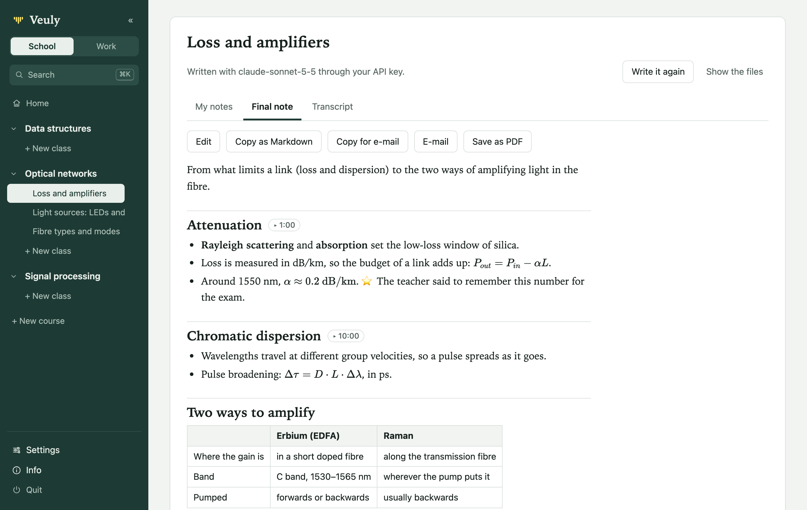

# Veuly

Record a class or a meeting, type your own notes while it goes on, and get one study note or one set of minutes at the end.
The recording is transcribed on your computer (whisper.cpp) and deleted as soon as there is text: Veuly keeps no audio, only the transcript.
No bot joins your call. The note is written by the AI you choose, with your own account.



Version 0.10.0. Interface in English, Spanish and Catalan. Free and open source under the GNU GPL v3 (see [License](#license)).

**Status.** Built and used by its author on a Mac (Apple silicon). Windows is built for but has never run on a real Windows PC;
the last section, "What has been tested, and what has not", says exactly what was and was not checked. Expect rough edges.

**Before you record anyone**, tell them. Many places require consent to record, and your school or company may have rules of its own.

**What it does**
- Classes: notes that use the course's slides, PDFs and past exams, a course digest, review cards (and an Anki file), practice exams.
- Meetings: minutes with decisions and action items followed from one meeting to the next, the transcript while recording, Catch me up.
- Your own notes typed during the class, with the moment each line was typed; pictures dropped in while recording.
- Optional: Obsidian, Confluence, calendars, a folder kept in step, a native Mac app that also records the computer's sound.

**Who writes the note.** Your own Anthropic or OpenAI API key (or any OpenAI-compatible service, including Ollama or LM Studio on
your computer), or, under Advanced, your own Claude Code or Codex sign-in. The transcript and your notes go to that service under your
own agreement with it, never through anyone else's server. See "Who writes your notes".

Veuly is not made, endorsed or sponsored by Anthropic, OpenAI, Atlassian or Obsidian.

## Start it from source

- **Mac:** double-click `run.command`, or run `python3 app.py` in this folder.
- **Windows:** double-click `run.bat`, or run `py app.py`.

It needs Python 3.9 or newer and no packages. It opens in your browser (use Chrome or Edge; Safari
and Firefox have not been tried). The first screen is Setup, which checks the rest:

| What | Why | How to get it |
|---|---|---|
| `whisper-cli` (whisper.cpp) | turns the recording into text, locally | the installers bundle it; from source: `brew install whisper-cpp` on Mac |
| a whisper model (`ggml-*.bin`) | same | Setup downloads one (570 MB), or it finds yours in `~/whisper-models` |
| one way of writing the notes | see "Who writes your notes" | an API key (Anthropic's, OpenAI's, or any OpenAI-compatible service's) is the recommended way and needs nothing installed; stored in the Keychain (Mac) or with DPAPI (Windows). Under Advanced: your own Claude Code or Codex, if installed |
| `ffmpeg` | only to import mp3, m4a or video files; a Mac converts m4a, mp3, aac, wav, mp4 and mov itself (`afconvert`), so there it is only for the rest, such as webm or wma | the Windows installer of `build_windows.py` bundles it; otherwise Mac: `brew install ffmpeg`, Windows: `winget install Gyan.FFmpeg` |

## The Mac app

On a Mac (macOS 14.2 or later, with Apple's Command Line Tools: `xcode-select --install`), Veuly can be an app of
its own instead of a browser tab:

```
python3 packaging/build_mac.py --install      build Veuly.app and put it in /Applications (dist/Veuly.app without --install)
python3 packaging/build_mac.py --dmg          also make dist/Veuly-mac.dmg, with a link to Applications
```

It is a small native window (Swift, `packaging/mac/`, built with `swiftc`; no Xcode project) around the same page and
the same server: the system's Python runs `app.py` from inside the bundle, the window shows the page, and the library,
its folder and everything in it are the ones the browser way uses. What the app adds:

- **A Mac app's habits.** A Dock icon and an icon of its own (drawn from `web/logo.svg` when it is built). Closing the
  window only hides it, so a class that is recording keeps recording; clicking the Dock icon, or opening the app again,
  brings the window back. It remembers its size and place. The menu bar has About, Settings… (⌘,), Hide and Quit; Edit
  (undo, cut, copy, paste, select all: in a web view these keys do nothing without it); View (reload, actual size, zoom
  in with ⌘+ or ⌘=, zoom out, full screen); Window and Help (which opens the Info pop-up). Menus and the app's own
  questions follow the interface's language (English, Spanish or Catalan), and so do the open and save panels when a
  language is chosen in Settings. A reload, from View or from anywhere else, asks first while a class records or a
  change is not saved, and lets the page save and send what it has before it goes; the web view's own right-click
  Reload is taken out of its menu.
- **Quitting.** ⌘Q asks the page first: if a class is recording, or a change on the page is not saved, or a note is
  being written, the app says so and asks; otherwise it quits at once. Then the page saves what was typed and sends the
  recording's last seconds, and the app stops the server it started (it asks it to quit, waits, then stops it), with
  anything that server started (a transcription, Claude Code). If the app itself is killed (a crash, Force Quit), the
  server notices, quits the same way and stops what it started; a class whose transcription or note was stopped that way
  says it was interrupted, and Try again goes on. The page's own Quit button quits the app too.
- **This computer's sound, natively.** A web view cannot record what the Mac plays, so the app does it itself, through
  a Core Audio process tap: everything this Mac plays except Veuly (the class or call in Teams, Zoom or a browser, a video,
  and also notifications). The first time, macOS asks to allow it ("Screen & System Audio Recording"). It reaches the page's
  recorder as a 16 kHz track, numbered by the sample, and the page keeps owning the recording: chunks, Mute, levels,
  Finish. With Both, the microphone and this track run on different clocks: the page lines them up when recording starts,
  corrects drift (two hours with a clock 200 ppm off end up within 45 ms of each other instead of 1.4 s), and when the
  Mac's sound stops coming it puts silence in its place and says so, the way it says a source was lost (and says it
  again when the sound is back), without ever holding the microphone's track back, also when this Mac's sound is started
  again in the middle; the last chunk of a recording holds all of the microphone. When the output device changes its
  rate under the tap (AirPods do when a call opens their microphone), the tap is built again at the new rate, from
  Core Audio's notice or, failing that, from the rate its frames really come at. The app starts it only right after a
  click in its window, and a start that a stop overtakes (a double click) is stopped as soon as it is done.
- **While a class records** the Mac does not go to sleep on its own and the app is never napped, even with its window
  hidden; that ends with the recording. A red dot and the recording's time sit in the menu bar meanwhile; its menu says
  which class records and has Mute (or Unmute), Finish class… (it shows the class and asks first, as the page's ⌃⇧F does)
  and Show Veuly. The Dock icon carries a red badge. While a note is written the item says so ("Writing the note… 40%"
  while the recording is turned into text, then "Writing the note…"), one line per class; nothing is in the menu bar
  otherwise. When a note is ready, or could not be written (with why), a notification says so, in the class's own
  wording ("Your minutes are ready" for a meeting); a click on it opens that class, at its note. macOS asks whether Veuly
  may notify the first time a class is finished in the app, never at launch; nothing is notified about the class you are
  looking at in the window in front. WebKit slows down the audio of a hidden or covered page that plays nothing (to
  0.7 of real time, measured), so the recorder plays a constant nobody can hear (-100 dB, not the microphone) and the
  microphone's track keeps real time with the window closed.
- **The lid closed while recording.** The Mac sleeps all the same, and nothing is recorded meanwhile. When it wakes up
  the recording goes on by itself: the audio is started again, a microphone that went away or went silent is opened
  again, and this Mac's sound is captured afresh (its device may have changed) and lined up with the microphone. The
  class keeps where and how long the Mac slept (`gaps` in `class.json`), and its page says so: "Your Mac was asleep for
  45 min (10:42–11:27). Nothing was recorded then; the recording went on when it woke up."
- **Open Veuly at login**, a line of Settings shown only in the app: the system's own login item for Veuly. When macOS
  wants it allowed first, the line says where (System Settings › General › Login Items) and has a button that opens it.
- **Everything a browser gives the page**: file pickers (an open panel), downloads and Save as PDF (a save panel, so no
  folder needs a permission), printing, alert/confirm/prompt, the microphone (for the app's own page only; macOS asks once,
  for Veuly), links to other sites (they open in your browser; only the app's own address loads in its window), and
  Open in Obsidian (it opens Obsidian).
- **If the server stops**, the window says so and offers to start it again (the address stays the same); with the window
  hidden, the Dock icon bounces instead of the window jumping in front of what you are doing. A class that was recording
  stops recording there and then, and what never reached the server stays in the window: Start again sends it, and what
  was typed, and the same page goes on where it was (finish the class, or go on recording). If the new server does not
  take it (another tab took the class over meanwhile, or the recording cannot be written), the class page offers to save
  it as a file, as it does in a browser. Quitting instead asks first. If its address was taken meanwhile and the new
  server serves another one, the page from before hands the app what it held (the recording's last seconds, the notes
  typed since, a Finish pressed just before) and the new page sends it and opens that class. A Finish pressed just before
  the server stopped is done once it is back. A transcription or a note that server was in the middle of is stopped with
  it (the app ends what the server had started), and the class says it was interrupted (Try again).
- A second copy started while one runs (or while `python3 app.py` runs in a terminal) shows that copy's library and
  leaves its server alone. `veuly-app.log` (next to `veuly.log` when `VEULY_HOME` is set, otherwise in
  `~/Library/Logs/Veuly`) tells what the app did, including what Core Audio reported.

Built as it is above, the app is signed ad hoc and uses this Mac's Python, which is enough on the Mac that built it. A copy for other people is built with `--standalone`, which puts its own Python and whisper-cli inside and fetches the transcription model on the first start, and needs a Developer ID and notarization (`packaging/SIGNING.md`). So far that copy has only started on this Mac, with a stand-in for whisper-cli; it has not met a Mac with nothing installed, nor a real signature. `--install`, and a build into a folder that already holds a `Veuly.app`, replace
only a copy that this script built, never an older installer's or anything else, and refuse while that Veuly runs. The
browser way (`python3 app.py`, `run.command`) is unchanged, and is still the way on Windows.

## How it works

```
browser page (web/)                             local server (transcapp/, 127.0.0.1 only)
  microphone and/or the computer's sound
     -> 16 kHz mono, 2 s chunks             ->  audio.pcm in the class folder
                                                live.py: whisper-cli every few seconds -> 2-transcript.txt so far
  the transcript so far, beside the notes   <-  (GET …/transcript)
  Catch me up, only when pressed            ->  catchup.py: the transcript so far and the notes -> engine, nothing stored
  a heads-up, only on a project that chose it -> headsup.py: about every 2 minutes, Haiku, usually silent, nothing stored
  your notes (Markdown, LaTeX, images)      ->  1-my-notes.md, img/
  Finish class                              ->  pipeline: whisper-cli on what is left    -> 2-transcript.txt
                                                          the recording is deleted: there is text now
                                                          engine (+ images, + course files) -> 3-final-note.md
```

**Each course** has its files (syllabus, slides, past exams) and a short quiz about how its notes should be
written. A file can also be added as a link: a web page is saved as its readable text, an online PDF
as the PDF, and a Google Doc or Slides link shared with "anyone with the link" as its export. A
page behind a login gives only its login screen, so those have to be downloaded and added as files. The answers become instructions (`transcapp/prefs.py`). Text is pulled out of each file
once, when it is added, by a separate process, so the rest of the app keeps answering while a long book is read (a class
recording in another tab included). Reading stops after two minutes: a PDF keeps the pages read by then, and its text says
the rest was left out; any other file that slow is refused. Every note gets the syllabus plus the slides of that class: the ones picked
on the class page, or, by default, the deck whose vocabulary matches the transcript best.
Terms are compared by their first letters, and acronyms and numbers count, so English slides still
match a class given in Catalan or Spanish. A deck too long to send whole (one PDF for the whole
term) gives only its pages that match the class, each with the page before and after it, in page
order. A PowerPoint file is read slide by slide in the order the deck shows them, with its speaker notes.

**The notes editor** is CodeMirror 6 with a live preview, like Obsidian: you type Markdown and see
the formatted note. Markers show only around the cursor, images appear in place of their path, and
`$...$` and `$$...$$` are drawn with KaTeX. The final note renders the same way.
Two shortcuts, typed at the start of a word: `mk` opens a formula (`$ $` with the cursor inside) and
`mp` opens a drawing pad in the notes, with five colours, three brush sizes, an eraser and undo.
A drawing is saved as an image of the class, goes to Claude with the other images, and reopens
with a double-click. Undo right after a shortcut gives the two letters back.
A picture on another site is never loaded by itself (that would tell the site what you are reading,
and when): the final note shows it as a link that names the site, and the editor leaves its line as
text. The pages load nothing from outside the app at all (a Content-Security-Policy says so).

**Your lines know when you typed them.** While a class records in that tab, each line you start gets
the recording's clock, shown in small at its right (`12:40`; a table or a formula shows it while you edit
it). It keeps that time when you edit it later, type over it or split it with Enter (both halves keep it),
and loses it when you delete or empty it; undo brings it back. A line you start in front of words that were
already there takes the clock once Enter sets it apart from them. A line typed before or after the recording
has none. The note is told these times (see "What the request says"), so a `??` is filled in from what was
said just before you typed it, instead of being guessed from its words. Clicking a time, once the class
has a transcript, shows that moment in the transcript; before, it says when the line was typed. A
screenshot pasted while recording is named after the same clock (`slide-001240.png`), so its name says
when in the class it came.

**The transcript** is made by whisper.cpp on your computer, one class at a time: a class finished
while another is being transcribed says it is waiting, and starts right after it. The class page shows
how far the transcriber is and about how long is left, and a Mac stays awake (`caffeinate`) until the
note is written; closing the lid still puts it to sleep. With "Detect it" the language is found on
stretches of speech from all over the recording, not from its first 30 seconds (whisper alone took a
silent start for English, and a Spanish introduction for the language of a Catalan lecture), and a class
that changes language is transcribed in pieces, each in its own language. A fixed language is a little
faster, but whisper translates into it whatever is said in another one. Lines written over silence or
steady noise ("Thank you.", subtitle credits) are dropped, and every line is moved to where its sound
is, so a sentence said right after a mute or a long pause is kept. When the transcript looks wrong (far
too few words for the time recorded, one line over and over, or no clear language), the class page says why;
its recording is gone all the same, so read the Transcript tab before trusting the note. "Transcribe again" (in a language you
pick) is offered only while a recording exists: one that gave no text yet, or one an older version kept. The
earlier transcript and note go to `versions/`. whisper's speech detector (`ggml-silero-*.bin`, next to
the model; Setup downloads it with the model) is used only to transcribe again, on its own, a stretch of
sound that no line covers: on a call's track whisper sometimes skips a short sentence there. Decoding
whole recordings with it was measured to join turns of a meeting and lose punctuation, so it is not.

**The transcript while you record.** What was said appears in a pane beside My notes (above them on a narrow
window) about ten seconds later, fifteen at most, transcribed on your computer while the class goes on. The recording is
cut at its quietest moment, so no word is cut in half; a stretch with no sound at all (a mute, a silent call)
is not transcribed; with two tracks each line says who said it. Click a line and it goes into My notes as a
quote (`> what was said`) on a line of its own, with the time it was said at its right, like a line you typed
then. The pane fills itself without touching what you are typing. After "Finish class" only the last part (and
anything the pane did not get to) is left to transcribe, so the note starts sooner:
measured on a Mac with the real whisper-cli, a piece of 8 seconds takes about 1.4 s, and Finish took 3 to 6 s instead of
9 to 12 s on three minutes of speech with its pauses. The transcript at Finish is made exactly as before from all those pieces
(the language found on the whole recording, every line checked against its sound, the two tracks merged, the
mutes), so it is the one a whole transcription gives, with whisper's windows cut at quiet moments; anything
wrong with the pieces (a restart of the computer meanwhile, another language found at the end) only means
the whole recording is transcribed, as it always was. While another class is being transcribed, or waits
for it, the pane waits, and catches up after (during a long "Import a folder" that can be the whole meeting:
then Finish transcribes it as before, right after the old recording being transcribed and before the others). Where a piece had to be cut with no real pause on a track,
a word may be split: a line in the pane can read wrong, and Finish decodes that stretch again across the cut, so the transcript keeps its quality and Finish takes a little longer (about 3-8 s for three minutes of
ordinary speech; for someone who never pauses, the time of a whole transcription). The pieces of about 8 seconds
were measured against pieces of half a minute: as many words missed (see the last section), for about twice the work while recording (whisper running 15 %
of the time instead of 8 %, 7.5 % of one CPU core instead of 3.5 %, on an M5). "Transcribe in short pieces" in Settings gives back the half-minute pieces
if you prefer the battery. A computer too slow for short pieces (one taking more than half its length, twice in a row) goes on with half-minute pieces
for that recording and says so; too slow for those as well, it turns itself off and says so. "Show the transcript while recording" in Settings turns it
on or off. The list does not scroll by itself while your pointer moves over it, so a line you are about to click stays where it is.

**Catch me up.** Lost the thread? The button on top of that pane sends what has been transcribed so far and your typed notes to
Claude, only when you press it, and shows a short summary there: on the school side the main ideas so far and what is being explained now; on the
work side what was decided, what is open, who owes what and what is being discussed now, in the language of the class or meeting. It says how far it reaches
("Up to 24:10 of the recording"); what was said just now is transcribed first when that takes only a few seconds. It goes through the course's Claude account,
uses your Claude plan (or your API key, and the button says which) like a short note and does not count as one of the free notes. A very long
meeting sends its newest part whole and says the start was left out. What you muted never goes. With the transcript off, or nothing transcribed yet, it
says so and asks Claude nothing (with the setting off, the button is below your notes). Nothing is kept: "Put it in my notes" adds the
summary at the end of My notes, with no typed time on its lines and your cursor where it was, and only then does it reach the final note, like anything you typed there.
Pressing again replaces it. The recording and your typing go on meanwhile.

**Heads-up during meetings (work side only).** It is off until you turn it on in a project's settings. While it is on and a meeting of that project records,
pieces of the transcript, your typed notes and the project's minutes, action items and files go to Claude Haiku about every 2 minutes, without you pressing anything, through the project's Claude account.
It uses your Claude plan or API key and does not count as minutes. Almost always it says nothing. It speaks up only when what is being said contradicts a decision, touches an open action item or a promise,
asks something already answered, misses a recorded risk, or is about to agree something against a recorded date or figure: one short message in a card over the top of the transcript, beside your notes or, in a narrower window, in the transcript's own place above them, with when it was said and where it comes from.
The card covers nothing of your notes, moves nothing and takes no focus, your typing goes on, and it makes no sound. No Mac notification and none of its words in the menu bar, because a shared screen could show them: only how many wait. The source's line opens its quote in place, so you stay on the meeting's page. Close dismisses it; "Put it in my notes" adds it at the end of My notes, and only then does it reach the minutes.
A quiet line says it is on and when it last checked, and a switch beside it turns it off for this meeting. There is no call without at least half a minute of new speech, and neither what you muted nor what was said with the switch off ever goes. With the transcript while recording off, it says so and makes no call.
Three failures in a row, a rate limit or a signed-out account stop it for that meeting with one quiet line. A check still running at Finish is stopped at once and its answer dropped. Nothing is kept: the messages live in memory until Finish, and a restart starts again. How useful its messages are has not been tried with the real Haiku.
In the Mac app the menu bar item shows only how many are waiting (`● 24:10 · 1`), and a line of its menu brings the window forward: never their words, so nothing shows on a shared screen. There is no notification.

## School and work

The switch at the top of the side panel has two sides. **School** is what the rest of this page
describes: courses, classes, study notes. **Work** shows projects whose "classes" are meetings and
whose final note is the minutes: purpose and outcome first, what was decided kept apart from what
was only discussed, and closing sections for decisions, action items (task, owner, due date) and
open questions. A project takes documentation as files (specifications, plans, earlier
minutes) and, under its quiz, example minutes as a model: new minutes copy their layout and
formatting, not their content, and they replace the "how it is laid out" answer. It has its own short quiz (how much detail, how it is laid out, who reads it,
and how action items are listed: a table, or a checklist to tick), and its meeting page reminds you to tell people you are recording.

Both sides share one library: a project is a course folder whose `course.json` says
`"kind": "project"`. The kind is chosen when it is created, by the side you are on, and does not
change. The recording has no speaker names, so the minutes name a person only when the meeting or
your notes make it clear, and write "not said" for an owner or a date nobody stated.

## Finding your way: home, course pages and titles

**Home.** The app opens on the home page of the side that is showing. "Needs you" lists every class
that waits for something: one recording now, one being written (with how far the transcriber is and
about how long is left), one that failed (Try again) and a recording that was never finished
(Finish). "Recent" lists the finished classes of the last seven days, at least the latest three,
each with its title, opening idea and section titles. A part shows only when it has something, and
the page follows what records or is being written by itself. A side with no course yet shows the
form that adds one, next to an example of a finished class; elsewhere "+ New course" opens that form
in a small pop-up over the page.

**A course's page** lists its classes, newest first: the day, the title, the opening idea, the
section titles, how long it lasted and, for a class that is not done, what it waits for, with Try
again or Finish beside it (a class another tab or window is recording says so, without Finish: only
that one can finish it). The filter above the list keeps the classes with every word typed, as it
is typed. The course's files, how its notes are written, where they also go (Confluence, Obsidian, a
Claude project) and its name and language are on its last tab, "Course settings" ("Project
settings" for a project), after the Digest (a project's Register) described below. A course with no files yet says so on its list, with the way there.

**The side panel** has "Home" at the top, then each course with its three newest classes (and the
one open, when it is older) and "All N classes". The arrow beside a course folds it to its name;
which courses are folded is kept in this browser only.

**Titles.** A new class is called after its date until its note is written. Claude is asked to open
the note with a title line, what the class covered in a few words, and the class takes it (when the
note has none, or one that says nothing such as "Notes", its first two section titles). A title you
type is yours: no note, rewrite or edit replaces it. One taken from a note follows the note: written
again, or its heading edited by hand. On the class page the note's title line is not shown a second
time under the title. Classes made by an earlier version are still called after their date: "Name
them from their notes", on the course's list, gives them the title their notes already hold, with no
call to Claude. A title goes where the note goes: the PDF's name, a new Confluence page (a page that
exists keeps its title, which may have been changed in Confluence; the page leaves out the note's title line, since its own
title says it), a new file in the Obsidian vault
(a file sent before keeps its name, so links to it in the vault keep working) and the copy for a
linked Claude project (renamed there at the next sync).

## Your calendar, and old recordings

**Your calendars.** In Settings › Calendars, add each calendar by pasting its secret address in iCal format
(Google Calendar: Settings › your calendar › Integrate calendar › "Secret address in iCal format";
Outlook: Settings › Calendar › Shared calendars › Publish a calendar › ICS) and saying whether it is for
School or for Work; up to 8. Each one gets a name you can change (by default the calendar's own name,
or its site's: "Google", "Outlook"), its side can be changed later, and Remove (asked first) forgets its
address; the calendar itself and the classes started from it stay. The home page of each side shows,
from that side's calendars only, what is on now (from ten minutes before it starts) and what comes next
today, merged in time order (an event that is in two of them shows once; with two or more, each says
which calendar it came from), with Start: it makes the class in its course and opens it ready to
record. A class is recognised by its course's name in
the event's title, whatever the case or accents; when your calendar calls it something else, give the
course its "Name in the calendar" in its settings (several names, by commas). A meeting started from
the calendar takes the event's title and its attendees (the organiser and those invited, not rooms or
those who declined); on the work side a meeting of no project is offered too, with a choice of
project (Outlook's published calendars list no attendees: from such a calendar every event of no
project is offered there, except a class of one of your courses). Start a second time and you get the class made the first time. Each address works like a
password, so the app keeps it in the system's key store (the Keychain on a Mac), never in
`settings.json` or the list of calendars (`calendars.json` in the data folder keeps only each one's name, side and site), never in a log, and never
shows it again: Settings says only which site it is on. Each calendar is read on its own, at most every
15 minutes, all of them at once; the home page shows the copy it has while a newer one is read. When
one cannot be read, the home page says so on a line of its own ("Outlook could not be read") and
shows what it read last, and the other calendars' events still show. If you had linked a calendar
before calendars had sides, it becomes the first of the list: on Work when it is an Outlook calendar
or more of its events are named after your projects than your courses, on School the other way round,
and otherwise on the side you had open (until it can be read, on that side or on Work for an Outlook
address); when it has events for both sides it stays on both, as two entries, so neither home page
loses anything; Settings says why until you press OK or change it. One calendar holding both classes
and meetings can also be added by hand, once for each side.
Repeating events (weekly, daily, with an end or a count, the days off
removed, one moved or cancelled), time zones (including the clock change) and all-day events (left
out) are understood, and so are the Windows time-zone names of an Outlook or Microsoft 365 calendar.
An `http://` address is asked over `https://`, and the app follows the calendar's redirects only over
`https://` to other sites, so the address never crosses the network in the clear.

**Import a folder.** On a course's page, "Import a folder" brings in recordings or transcripts made
before (a recorder's files, Zoom or Teams recordings, last year's lectures): choose a folder (its
folders too) or some files. Each file becomes a class, dated from a date in its name (2026-10-05,
2026_10_05, 20261005, or 05-10-2026, day first) with the time after it when there is one, or else from
the file's own date; titled from its name without the date and the words a recorder adds ("REC",
"Recording", "Grabación"). Before anything is sent you see what each file will be, can change a day or
leave a file out, and choose "Transcribe and write the notes" or "Only transcribe" (no Claude usage:
each class then says "Transcribed" and has "Write the note" for when you want it). Files that are not
a recording or a transcript, hidden files, a recording whose transcript is beside it (the transcript is
used) and files brought into the course before (so an import cut short can simply be run again) are
left out, and the list says why. The files go in one at a time, oldest first, and are transcribed in
that order, one at a time, while the page stays open (you can close the pop-up and keep working). A
class you record meanwhile does not wait behind them: it is transcribed right after the one in progress.
The import stops before a recording would leave less than 3 GB free, so what you record next has room.
"Only transcribe" stays the choice for those classes: Try again after the app was closed, or Transcribe
again, still writes no note; only "Write the note" does. The
app never reads the folder itself: the browser's own chooser hands it the files, which in the Mac app
means macOS never has to ask for permission to read Desktop, Documents or Downloads. The
converted copy of an imported recording goes as soon as its transcript is written: your own file is still where it was.

## A folder that keeps a course in step

The teacher's slides, or a project's documents, are already in a folder on your computer. On a course's or project's
settings page, in its files, "Keep in step with a folder" links it: in the Mac app you choose it in a real folder
panel, in a browser you type its path (a web page cannot get one from its file chooser). Up to 5 folders per course, each
with the kind of file it brings (Slides, Past exams, Documentation and so on; asked when you add it, Slides or Documentation by
default). The row shows the folder, when it last looked, how many files it brought and what came in last, with Look now and Stop.

**It goes one way.** Veuly only reads your folder: it never changes, moves or deletes anything there, and nothing is sent
anywhere (this uses no Claude). New files come in, with subfolders (6 levels, 2,000 files at most); hidden files, Office lock files (`~$…`),
`.DS_Store` and symbolic links are left out, and a link is never followed out of the folder. A changed file replaces the course's
copy, and the old copy goes to the trash; a file whose date changed but whose bytes did not is left as it is. Files come in the same way as
those you add by hand: a limit of 60 MB, their text read once by a separate process, then searched and used in notes like any other.
A small mark beside a file says it came from the folder. If a limit stops it, or a subfolder cannot be read, the row names what was left out.

**Nothing is lost.** A new version that is empty, not fully written, unreadable or without any text never replaces a good copy: the row says so, the copy stays, and
it comes in when the file changes (Look now tries again). A real new version replaces the copy, and the old one can be got back from the trash; if that happens to a PDF while Claude is writing a note, that note shows no page of the file, since Claude read the old one. A file deleted from the folder stays in the course, marked "no longer in the folder", with its Remove button; a file
you Remove while it is still in the folder stays out until a new version of it appears. A folder that is unplugged or that the
computer does not let Veuly read says so once, on the row and in one message, and changes nothing in the course: a deleted folder never empties a
course. A file you added by hand with the same name is left alone and listed as such. A file moved or renamed inside the folder
stays one file. iCloud's or OneDrive's placeholders of files not on this computer are listed, not downloaded. Stop leaves the files in
the course as its own, and linking the same folder again, also after renaming it, takes back the files that have not changed. The whole disk, your home folder or what holds it, system folders and Veuly's own folder are refused, however they are spelled, also when a path is edited by hand in `course.json`.

**When it looks:** when the app starts, when you open that course's pages, before a note or minutes read the course's files (for 5 seconds at
most, so a slow folder never delays a note: the look goes on by itself and the note uses what is there), and about every 10 minutes while the
app is open. A large first sync goes one file at a time and shows how far it is, on the settings page and above the course's list; if you
quit half way, the next look carries on, with nothing half added. **While a class records it does nothing, not even list the folder**,
and while a transcription runs it waits too (except for a note about to be written); it says so on the row and carries on half a minute after.
A library with no linked folder does no work at all. Only the folders you linked are ever read; if one is on your Desktop or in Documents
or Downloads, on a drive or in cloud storage, macOS may ask once whether Veuly may read it.

## Who said what, and what came before

**Two tracks.** Recording "Both" keeps the microphone and the computer's sound as two recordings.
Each is transcribed on its own and the transcript marks every line `[me]` or `[others]`, so the note
knows which commitments are yours. It takes about twice as long to transcribe. Wear headphones:
without them the microphone hears the call too. Lines the microphone only repeats from the call are
dropped, and so are the words the transcriber invents over a silent stretch of a track. Each line is
placed where its own track has sound, so an answer never comes before its question. `[others]`
is everyone else as one voice: the app does not know which person spoke.

**Names for the voices, from Teams.** On a finished meeting recorded on two tracks, the Transcript tab has **Add the Teams
transcript**: give it the `.vtt` or `.docx` file Teams lets you download from the meeting's transcript. Veuly lines it up with
your recording by time (Teams' clock starts when its transcription did) and by the words both say, and marks each Others line
Teams gave to one person with that name (`[others: Ana García]`); the Transcript tab and search show the name. A line Teams split
between people, or whose words it does not have, stays Others; your own lines are never touched, and your name (or one of
the names people call you, in whatever order Teams writes it: "Soler Pérez, Iván") is never given to an Others line. The transcript it replaces
is kept in the class's `versions/` folder. Then **Write it again** writes the minutes knowing who said what. A file from another
meeting, or in another language, does not line up: nothing changes and the page says why. Nothing is sent anywhere for this.

**Attendees.** A meeting has a line for who is in it. It gives the minutes the right spellings and
the list of who was there; it does not say who spoke.

**Earlier notes.** Each new note is told about the last five classes or meetings of its course that
have a note: date, title, opening idea and section titles, taken from the notes themselves. A
meeting also gets the end of the previous minutes and every action item of earlier meetings still open (with its meeting's
date, owner and due date), so the minutes can say which were done and which changed. Settings can turn this off.

## Action items you can tick, and what you owe

Minutes end with their action items, as a table (task, owner, due date) or, with the quiz's "How action items are listed:
A checklist", as lines in the form of Obsidian's Tasks plug-in: `- [ ] Send the notification — Laura Gil — 📅 2026-10-28`.
Veuly reads both (and the shapes Claude bends them into), in English, Spanish and Catalan.

- **Tick them.** On the Minutes tab each action item has a box (a table's in its task's cell). Ticking changes only that line of
  the minutes: `[x]` and ` ✅ <today>` after it (in a table, after the task, or in its status column when it has one), and the
  Claude-project copy and search follow. Tick again to undo. A meeting being written again cannot be ticked meanwhile, and
  minutes written again (after the Teams transcript, say) keep the ticks of the minutes before; an edit of the minutes started in
  another tab before a tick is saved with the tick, not against it. Copied to Obsidian, the checklist shows in the vault's task queries; published to
  Confluence, its lines become Confluence's own tasks, with their due dates.
- **What you owe.** Settings has your name and, on the work side, **How people call you** (other names, separated by commas, which
  stay on this computer). An item is yours when its owner is one of those, your first name, or "me". The home page of the work side
  shows **You owe 3 (1 overdue)** and **Others owe you 6**, soonest first, each opening its meeting at its line.
- **A project's Action items page** (next to its meetings and its register) lists every item once: yours, others', those with no
  owner yet, and those done, each with its box. A task that later minutes carry forward, or report as done ("✅ … (from 7 Oct)"), is
  one item, shown by its newest line; tasks with different numbers ("BCN-01", "BCN-02") stay apart.
- **The next meeting.** A new meeting's page says how many items earlier meetings left open (and how many are yours), and **Put
  them in my notes as the agenda** adds them at the top of My notes, which the minutes follow.

## From the note back to what was said

**The transcript** tab shows what was said line by line, each line with its time. With two tracks your lines
and the others' are told apart by colour, and named where the voice changes; a mute says how long it lasted.
A transcript imported from Teams keeps its speakers' names, and one imported as plain text shows as text.

**No audio is kept.** Audio is on disk only while it is needed to make a transcript. As soon as there is any text the
recording goes, both tracks, before the note is even asked for and even if the transcript looks wrong; a note that fails is tried
again from the transcript. With no text at all (the transcription failed, a recording was never finished) it stays so you
can try again, and the class page says what comes: Veuly transcribes it once more by itself, on this computer and with no AI call, at each start (a recording left open only once 24 hours old) or when
24 hours have passed with the app running, one at a time and after any class recording or waiting. The 24 hours run while the app is closed or the Mac asleep, so nothing is deleted before that try. With text the audio goes as usual and the class waits for Write the note; with none it is deleted then, and the page says that. Try again by hand on such a recording is that try too. With no transcriber on this computer the try counts as failed once the model's download has failed, or after a further 24 hours with the app open. Nothing plays a
recording: a section's moment or a time in the note opens the transcript's line. Recordings an older version of Veuly
kept are never deleted unasked: Settings shows how many there are and their size, with one button that deletes them
after a question (the ones in the trash folder too), and shows nothing when there are none.

**From a section to the moment.** On screen, each section of the final note has "▸ 12:40" after its heading:
where that section starts in the transcript, worked out from the words the two share, going through the class in
order. A click opens the transcript there, the line marked (the keyboard goes
on from that line), and "Back to …" returns to the section, to its "▸". A time Claude wrote in
the note, such as "(00:41:10)" after a self-test answer or in an action item, becomes a link only when the words
around it were said near that time (a short answer is read with its question): a clock time such as "10:00" stays
text. Its "Back to …" returns to the heading it is under, such as "Answers". The closing sections (self-test,
glossary, action items…) get no time of their own; their items do.

**Slides.** "slide 14" or "page 14" in a note (in Spanish and Catalan too) opens, over the page, at that page,
the course's PDF named beside it ("page 2 of the Course guide"), or else the PDF the class used; another PDF of
the course can be picked there, and in a browser it can open in a tab of its own. A PowerPoint deck has no pages
to open, so its slide numbers stay text.

Nothing of this is written into the note: the PDF, Confluence, Obsidian and "Copy as Markdown" get the note as
it is.

## Pages of your files in the notes

Your PDFs reach Claude as text, so it could only cite "slide 14". Now, when a class or a meeting really spends time on a figure, a
diagram, a chart or a table in one of the course's or project's own PDFs, the note or the minutes show that page, as a picture, where
it is discussed, with what to look at, the file and the page under it. On the note's page, "p. 14" in that line opens the PDF at that page.

- **Claude picks, the app draws.** The app works out on this computer which pages hold a figure, a chart or a photo (a page that is only
  text does not count, nor the template's logo or a formula set as a picture) and says so beside those pages in the request, sending
  no more of the file than before. Claude asks for a page with a mark only the app reads, at most six in a note. The app checks each one against the
  files given in that request and draws it from your own file; a wrong one, or one that cannot be drawn, is left out with nothing to show for it, and it
  never costs you the note.
- **It is an ordinary picture.** The note holds a normal picture line in `img/` (`page-….jpg`, 90-180 KB each on the decks tried, sharp at 1400 px), so
  it goes to Obsidian, Confluence (with an API token; through the connector a picture is named instead, like any other), the PDF and Copy as Markdown. **Write it again**
  uses the same picture for the same page and leaves your own pictures alone; with a request, Claude is sent the pages the note shows, as it is sent the pictures of your notes.
- **The setting** is on a course's or project's settings page, in the preferences, on by default: "Show pages of your files in the notes". Off, the request is exactly what it was before this existed.
- **PDFs only for now.** A PowerPoint file stays as text. A page with no text at all is not offered to Claude, which would know nothing about it.
- It uses `pdftoppm` when it is there (Homebrew's poppler) and otherwise, on a Mac, the system's `sips`. With neither (Windows or Linux without poppler) a note simply has no pages.

## Screenshots and photos that add themselves

While a class or a meeting is recording, a picture that reaches the computer goes into the notes
without pasting: a screenshot you take of the slides or of what someone is sharing, a photo sent
from your phone with AirDrop, an image you download. It lands under the line you are writing and
the cursor stays where it was, so you keep typing; on an empty line it takes that line and you
continue below. A message at the bottom says which file was added. If the notes are not on screen
(another tab, another page), it is added at the end of the saved notes.

The page cannot see the disk, so the local server looks: every two seconds, in the system's
screenshot folder (on a Mac the one set for screenshots, the Desktop unless you changed it; on
Windows `Pictures\Screenshots`), in Downloads (where AirDrop saves), and in one more folder if you
give it in Settings. "New" means it was not there when the recording started, not that its date is
recent: a photo sent from a phone keeps the date it was taken. A file is copied once it has stopped
growing and is whole (a PNG or JPEG must end the way one ends, so a copy that pauses halfway is not
taken); the original is never moved or deleted. On a Mac an iPhone photo in HEIC is converted to
JPEG with the system's `sips`, because neither the browser nor Claude reads HEIC, at most 2,560
pixels on its long side; a picture too big for Claude (over 3.7 MB) is brought down the same way, and
a HEIC that `sips` cannot read is left out after a few tries. Nothing is picked
up when no class is recording, and Settings has the switch to turn it off.

Things to know: a Mac shows a floating thumbnail for about five seconds before it saves a
screenshot, so the picture arrives after that (Screenshot app, Options, untick "Show Floating
Thumbnail" to make it immediate); a screenshot taken to the clipboard only (with Control held) is
not a file, so paste it; anything else that lands in Downloads as an image while you record is added
too, and you remove it by deleting its line; the first time, a Mac asks to let the app (or the
Terminal it runs in) read Desktop and Downloads, and if that is refused the page says so: a red line under
the notes names the folder for as long as the class records, with the two ways out (allow it in System Settings, Privacy & Security,
Files and Folders; or have the Mac save screenshots in another folder, such as Pictures, which needs no permission).

## Writing a note again, and saving it as a PDF

**Write it again** on a finished note asks what should change ("shorter", "a table comparing TCP and UDP", "explain the second
section better"). What you type is sent to Claude together with the version you read and everything the first writing had, and the
note is written again in full. Left empty, it is a plain rewrite, as before. The version you had is kept in `versions/` either way.
The request applies to that one rewrite, unless you tick "Also for the next notes of this course" ("…minutes of this project"):
then it is also added, on a line of its own, to the course's "Anything else" (the box under its quiz, in Course settings), where you can read, change or
remove it, and every later note follows it too. The same request is not added twice.

**Save as PDF** on the Final note tab puts `<class title>.pdf` in your downloads, with formulas, tables and images as on screen and
text you can select. The app has no PDF writer of its own: it starts a Chrome, Edge, Brave or Chromium that is already on the computer,
without a window, on a page that shows only that note (`transcapp/pdf.py`), with a throwaway profile that keeps its keys in memory, never
in the login Keychain (Mac) or the desktop's keyring (Linux). Edge comes with Windows. On a computer with none of them
(a Mac with only Safari), the button opens the print window instead, where "Save as PDF" is one more click.
The PDF says which language it is in (screen readers go by it): the course's, or with "Detect it" the app's.

## Search, and the keyboard

**Search** is the field at the top of the side panel. Type a word or two and press Enter: the search page lists what was
found in every final note, your own notes, the transcripts and the course files, grouped by course and by class, best first
(at a like match, a section of a note comes before your notes, a course file and the transcript). Accents and capitals do not
matter ("dispersion cromatica" finds "dispersión cromática"), the word you are typing also counts as the start of a longer one,
and "words in quotes" are found together. Typing more on that page narrows it as you type. The chips keep only some kinds
(final notes, my notes, transcripts, course files), the list keeps one course, and the search follows the School / Work switch,
with a tick for both sides; the other side's courses are marked and keep their own words (a project's results say "Minutes").
A result opens where it was found: the final note at its section, your notes with the words selected, the transcript at the
moment they were said, and a course file where its course lists its files, with its row marked. A course file is searched in
the text the app took out of it when it was added, page by page or slide by slide, so nothing is read again.

Nothing is written anywhere for this. The app reads the library into memory the first time you search (it starts as soon as
you click the field: about 3 seconds for 600 classes), looks at what changed at every search, and lets it go 15 minutes after
the last one. Where the Python running the app has no full-text search in its SQLite, it scans the same text instead: the same
answers, slower and with more memory.

**The keyboard.** ⌘K on a Mac (Ctrl+K elsewhere) opens a small window to search, go to a course or a class, or start a new
class in a course (on a course's page, that one comes first). On a class page, Ctrl+Shift+R starts recording, Ctrl+Shift+M
mutes and unmutes, Ctrl+Shift+F finishes after asking, and Ctrl+1, 2 and 3 open My notes, the Final note and the Transcript.
They are Control keys on a Mac too: the Mac app's menus use ⌘, and Option types @ # | on Spanish and Catalan keyboards, so
neither is used. A key does something only where it can, so typing in the notes (with AltGr or Option too) never sets one off,
and on a Mac Ctrl+K in a text keeps deleting to the end of the line. Info lists them, with ⌘S (Ctrl+S), which saves.

## What a course's notes add up to: the Digest and the Register

Every course has a **Digest** next to its classes, and every project a **Register**. Veuly reads them from the final notes
themselves, from the sections the notes close with and the marks Claude writes in them: no Claude call, nothing sent, nothing written.

- **Exam radar.** The dates to come, from the notes' exam sections, soonest first and with the exams marked (a date said again in a
  later class is listed once; the button that jumps to the radar shows the day of the next exam); what the teacher said about the
  exam, dates and deliveries, newest class first (older classes than the six newest wait in a fold); and the parts of the classes
  that the notes say were asked in past exams.
- **To check.** What the recording left unclear and where your notes and the teacher disagree (the note's "Check" boxes), wherever
  the note says so, its exam section included: worth asking, or looking up in the slides. What you marked `??` in class waits in its
  own fold: the note answers it, but read it again.
- **Formula sheet.** Every formula the notes set on a line of its own, each once, in the order of the course, under the heading it is
  in, with the line that introduces it and what its symbols are when the note says. **Print the formula sheet** opens the print window
  with only the formulas, class after class under the headings they are in, in a browser and in the Mac app; "Save as PDF" there makes
  a file named after the course.
- **Glossary.** Each term once, in alphabetical order, with the class that defined it first (and the others that did), and a search.
- **Register** (work): the decisions, the open questions and the risks of the minutes, newest meeting first. Whether a question was
  answered at a later meeting is not known without reading the later minutes, so every one is listed with its meeting's date.

Each item opens its class on the Final note, at the heading it comes from (under a heading the note repeats, such as a second
"Example", at the heading above it). A part the course's quiz does not ask for says which box to tick, and **Show me** opens the
quiz at that box. The closing sections are found from the end of each note, in the order the quiz asks for them, and by their names
in English, Spanish and Catalan, so minutes laid out like example minutes (decisions first, a line in bold instead of a heading, a
"Decisions" under each topic) are read too, and a note in another language is read by position. Dates are read as Claude writes
them ("Tuesday 3 November", "12 de noviembre", "30 d'octubre"), with the year taken from the class's date.

## Ask a course or a project

Every course and project has an **Ask** page next to its Digest (Register), and the home page has a box that asks every course
(project) of the side on screen. Type a question in your own words, in any language ("How did the teacher solve the OSNR
exercise?", "¿Qué tengo pendiente esta semana?"), and press Enter or **Ask**. Claude answers from your own material only, in the
language of the question, and says plainly when your notes do not cover it. Each part of the answer carries numbered chips:
a chip, or a line of the **Sources** list under the answer, opens the class at the section of the final note it comes from, the
transcript at the moment it was said, your typed notes, or the file in the course's list. Coming back to the Ask page finds the
question and its answer still there while the app is open; nothing of it is written anywhere.

What Claude gets for one question (about 40,000 characters at most, roughly 10,000–15,000 tokens): a map of the classes with a
final note (the day, title, opening idea and section titles of each; on a big library the newest ones), the parts of the final notes,
typed notes, transcripts and files that share words with the question (the notes first), and then more of the notes of those
classes and of the newest ones, so a question in English about a class in Catalan still gets its notes. Nothing of another course
or project goes with it. It uses your Claude plan (or your API key) like a short note, and takes about half a minute; a question
does not count as one of the free notes. Without a way to reach Claude set up, the box says so and opens Setup.

**Save this question** under an answer keeps it on that course's Ask page, as a chip that asks it again ("What do I owe this
week?" before every Monday meeting); × takes it out. Saved questions live in the course's `course.json` (`asks`), with your other
course data. Before any is saved, the page offers a few examples of what to ask.

## Studying a course: review cards, practice exams, the whole course

A school course has two more pages, **Review** and **Practice** (a work project has neither).

- **Review cards.** Every final note ends with a Self-test by default: each of its questions, with its answer from the Answers block,
  is a card. Tick **Flashcards** under "What goes at the end of each note" and the next notes also end with `question :: answer`
  lines (the same lines Obsidian's spaced-repetition plugins read), which make cards too. **Review** shows one card at a time:
  **Space** (or the button) shows the answer, then **1 Again, 2 Hard, 3 Good, 4 Easy** (or the buttons, each saying when the card
  comes back). Good brings it back after 1, 3, 7, 16 and 35 days, then further each time; Again brings it back at the end of the
  round. A course brings 20 new cards a day. Give it its **exam date** and every card comes back at least twice before the exam (and
  more new cards a day when that needs them). "From <class> · 6:47" under an answer opens the class's transcript at the moment the
  answer names, or its note at the section. A course's list says "23 cards to review today", and the home page's **Review today**
  tile lists what each course has due and how many days are left to each exam; **Review all** goes through every course at once.
  A note written again keeps its cards' history as long as a question stays the same. **Download for Anki** saves every card of the
  course as a file Anki imports (File › Import, into the deck "Veuly::<course>"); importing it again updates the cards instead of
  adding them twice. Formulas come out as Anki's MathJax reads them; pictures are left out for now.
- **Practice exams.** Choose the classes (all of them by default), how many questions, the time allowed and whether the solutions
  come after the questions, and **Write the practice exam**: Claude writes a mock exam in the format, kinds of question, points and
  difficulty of the course's past exams (its "Past exams" files), on what those classes covered only, with questions of its own (never
  a past one), each saying which class it comes from. Solutions go step by step, each with its reason, and a numeric result says "check
  against the course's own solutions": nobody checked them. It uses your Claude plan as a note does (it does not count as one of the
  free notes) and takes a few minutes, in the background: the page shows when it is ready. Each exam is saved as
  `practice/<date> Practice exam.md` in the course's folder and listed on the page; open one to read it with its solutions behind a
  button, **Print** it (what shows is what prints; in the Mac app, its print panel) or delete it (to the trash).
- **The whole course in one document.** **Download as Markdown (.zip)** gives one `<course>.md`: a title page, the contents, every
  final note in date order under its title, the formula sheet and the glossary of the Digest, with the pictures in `img/` (named as
  the Obsidian copy names them), and the practice exams beside it. **Print the whole course** shows every note in the app, one class to
  a page, after a contents page, and prints it (or saves it as a PDF from the print window).

## Sending the note or the minutes

The Final note tab (Minutes, at work) has, next to "Copy as Markdown":

- **Copy for e-mail** puts the note on the clipboard as formatted text for a message or a chat: headings, lists, bold, and
  tables with their borders, all as inline styles, the kind mail programs keep when pasting. Formulas go as their LaTeX in a
  code font (a message has nothing to draw them with) and pictures as their names (`[image: slide-001240.png]`): the
  pictures stay on your computer. Whatever takes no formatting gets plain text instead: lists keep their marks and a table
  goes row by row.
- **E-mail** does the same and opens a new message in your mail program, with the subject filled in as
  `<course or project> · <date> · <title>` (the title is left out while it only repeats the date, as "Class of <date>" does,
  in whichever language the app gave it): paste into it and send. Nothing is sent by the app, and the message has no addressee:
  you choose who gets it.
  On a meeting it also fills in who it goes to: the attendees' addresses when the meeting was started from a calendar event that lists them (you are left out, by the name in Settings), otherwise the project's usual people (its settings: "Who the minutes usually go to"; Outlook's published calendars list no attendees). You can change them in the field beside the button. Veuly sends nothing: you read the message and send it from your mail program, and these addresses never go to Claude.
- **Copy the action items**, on minutes that have that closing section, copies only it, also formatted. It is found by its
  heading as the minutes write it ("Action items", "Acciones", "Tareas", "Tasques"…); a topic that only starts with those
  words is not it. A checklist's boxes go as ☐ and ☑.

## When something goes wrong while you record or write

**One tab records a class.** Opening Veuly again opens another tab. There, a class that is being
recorded elsewhere says so, with the time recorded so far, and offers no Finish: you finish it where
it records. "Record here instead" is for a tab that was closed or stopped answering: after you
confirm, the recording goes on in this tab, and the other one stops and says why. Closing or
reloading the recording tab frees the class at once; a tab that crashed frees it after 20 seconds.
"Continue recording" always goes on from what the app has saved, also in a tab opened earlier.

**What is recorded reaches the class, or the page says it did not.** Each two-second piece is written once, and answered only once it is
on disk; one that arrives cut short is refused and sent again. If saving stops (a full disk, the app
not answering), the recording carries on in the page and the line next to the buttons says why. Mute
never waits. Finish waits up to 20 seconds; then a red notice says how much is only in the page and
offers to keep trying or to finish with what is saved, which loses that part. A Finish that failed (the disk filled while the recording
was converted) can be pressed again and goes on where it stopped, and one the app does not answer
within a minute says so instead of "Saving…" for ever. When another tab takes the recording over or
finishes it, or the class is deleted, the tab that was recording stops at once and says so in red, with
how much it had not sent: that part is lost, since Veuly keeps no audio anywhere else.

**A source that stops.** If the microphone is unplugged, the app opens the computer's default one by
itself and says which; if it cannot, a red notice offers to try again (and it tries when a microphone
is plugged in). A tab or screen that stops sharing gets a "Share again" button. The screen is kept
awake again whenever you come back to the tab. If macOS blocks the microphone for the browser, the
message says where to allow it, and with Both a blocked microphone is no longer reported as "nothing
was shared".

**Your notes.** A save that fails is tried again, more slowly each time, and a line under the notes
says they are not saved yet; the page does not leave them, and closing the tab asks first. Cmd+S
(Ctrl+S) saves at once. Typing while the next page loads is saved before the page changes. If the
class is deleted in another tab, the page says its notes can no longer be saved, offers to copy them,
and asks before leaving them behind. Two tabs on the same class cannot overwrite each other: a tab
whose notes were changed elsewhere stops saving and asks which version stays, and the other one is
kept in the class's `versions/` folder (`my-notes.<date-time>.md`). The final note works the same
way, and a tab switch, another page, Write it again or Transcribe again asks before dropping changes
you have not saved. When the note arrives while you are typing in My notes, the page stays where you
are and offers it, and says so when your latest notes came after it was written.

## Quitting, and movement on the page

"Quit" asks before it stops the app, in a small window in the middle; Escape or a click outside
cancels. If a note is still being written it says that quitting interrupts it: the transcriber and
Claude Code stop with the app (closing its Terminal window does the same), and the class offers Try
again the next time. While a class is recording, in this tab or another, Quit is refused, and closing
the browser tab gets the browser's own warning, as it does while notes are not saved yet. When the app
is not running, the page says so in its own language; so does every refusal of the app, such as a
full disk or a file another program holds.

Movement is short and has a reason: a page you navigate to fades in (a redraw of the page you are
on does not), buttons give under a press, messages rise from the bottom, pop-ups grow slightly from
the middle, and the recording dot pulses in the side panel too. With "reduce motion" set in the
system, things only fade.

## A Claude project, in both directions

A course or a work project can be linked to one of your Claude projects, so its notes know that
project's terms, people and earlier decisions. In the course's settings, type the Claude project's name
and press Link. The app cannot read a Claude project, so the context is brought by Claude: in the
Claude app, open a task inside that project with this computer linked and say the sentence the
settings show ("Sync this project to Veuly. The folder is: ..."). Claude writes a one-page
card and the project's documents into the app's `claude-projects` folder; the settings then
say when the context arrived and how many documents it has, and the card and the documents are
listed with the course's files under "Claude project context" (a list only: a new sync changes it).

Every note of a linked course gets the card, plus the documents: all of them when they are small,
otherwise only those whose vocabulary matches what was said. The note marks what comes from there
with "(from the project)". The app has the copy from the last sync, so sync again when the Claude
project changes. Removing the link moves what had arrived to `claude-projects/.trash/`.

The other direction is a tick box on the same sheet, "Also send the final notes to this Claude
project" (ticked when you make a new link; a link made before this existed stays off until you tick
it). With it on, the app keeps a copy of every final note of the course in
`claude-projects/<course>/out/`, and the same sync sentence makes Claude put them into the project
as documents named `veuly/<course>/<date> <time> <title>.md`, so any chat in that project can use
what was said in class or decided in a meeting. The sheet says how many are in the project and how
many wait for the next sync. Only the final note goes: not the transcript, what you typed, the
recording or the images (an image becomes the words `[image: ...]`). The app's copy is the original:
a note you edit here is written again there, a class you delete here is removed there, and an edit
made in the Claude project is overwritten the next time the note changes here. Only notes that
changed are written again. Turning the box off, or removing the link, stops sending and leaves in
the project what is already there. A note that was sent is never used as "project context" for the
notes of a linked course, even though the next sync finds it in the project: a course already knows
its own earlier notes, and feeding them back would count them twice.

## Settings

"Settings" in the side panel holds how the app behaves: its language (and, in the Mac app, whether
Veuly opens when you log in), recordings an older version kept and the button that deletes them, whether the transcript shows while recording, your name (so the
minutes can name you as the owner of what you took on) and, on the work side, how people call you (to find the action items
that are yours), your calendars, each for School or Work (see "Your calendar, and old recordings"), the folder for
Claude projects with the list of what is linked, the AI accounts (see below), and where your notes are.
"Setup" stays for installing and connecting things (the transcriber, who writes the notes, Confluence).

## AI accounts

You can choose who writes each course's notes and each project's minutes: your company's gateway for
work, your own key for classes. Settings › **AI accounts** lists what Setup sets up (as before: nothing
changes until you add an account). An account can be, in the order the form offers them:

- **An Anthropic API key** or **an OpenAI API key**, each kept in the system's key store. Its model is
  Setup's unless it names its own.
- **Another service**: anything that speaks OpenAI's language (OpenRouter, a company gateway, Ollama or LM
  Studio), with a name, an address and a model typed as that service writes it. A key is needed unless the
  service is on this computer. The address must start with https:// (http:// only for 127.0.0.1 or localhost);
  the key goes only there, a redirect is refused and not followed (so neither the key nor the text goes on to
  another address), and giving the account a new address deletes the key it had. Under Optional: the small
  model for heads-ups and the most tokens one request may hold (200,000 unless it says; a class too long
  for it stops before anything is sent, and a service's own "too long" answer reads the same).
- Under **Advanced**, a sign-in of its own in **Claude Code** or **Codex**, if installed. You sign in inside that
  tool, in a Terminal window: Veuly never sees or keeps that login. Anthropic's docs say developers building
  products should use API keys and may not offer Claude.ai login in their own apps or collect or store its
  credentials, while a user signing in to the unmodified Claude Code with their own subscription is allowed; OpenAI's
  docs recommend API keys for automation. So API keys are the recommended way, nothing here sells a subscription, and
  services are named in plain text only, with no logo.

The rest of this section tells the Claude Code way; a Codex account works the same (`codex login`,
`CODEX_HOME`, its folder in `codex-accounts/<id>/`). On the page, a class and Info say which service its text goes to, by
its name or host; a note says who wrote it. What only Claude Code can do (the Confluence connector, the Obsidian agent) says so
plainly on any other account, and the Confluence API token works for everyone.

To add a work sign-in: **Add an account**, call it "Work", open Advanced, choose "Claude Code, with a sign-in of its own",
and press **Add the account**. Then press **Sign in** on its line: Terminal opens on
`claude auth login` for that account only, and you sign in in the browser with your work account.
Back in Veuly, **Check again** shows "Signed in as you@company.com · Company". (If your browser is
signed in to claude.ai with your own account, the page offers that one: switch to the work account
there, or open the link Terminal prints in a browser signed in to it; the e-mail shown tells you which one it took.) Then set **Work
uses: Work**. From now on every project's minutes are written by the work account, and the classes
by this Mac's own.

- Each course and project can choose its own account in its settings ("AI account": "Same as
  Work (Work)", or a given one). A class's page says in one quiet line which account writes it, and
  which one wrote it.
- Everything Claude does for a course goes through its account: the note or the minutes, Write it
  again, Ask (a course's or a project's own; a whole side, that side's; everything, this Mac's),
  practice exams, Confluence through Claude (the connector is the account's own: the work
  account's Atlassian connector is the one used for work), the Obsidian agent, and Test.
- Each added account can choose its own model in that list (Sonnet, Haiku or Opus), so work can write with
  Opus and classes with Sonnet; "As chosen in Setup" is the default. This Mac's Claude Code uses the choice in
  Setup. Publishing through the Confluence connector stays on Haiku, and the Obsidian agent has its own setting.
- An account can also write with an API key of its own instead (kept in the system's key store,
  never in `settings.json`). It cannot run the Confluence connector or the Obsidian agent, which
  need a Claude Code sign-in; the app says so when a course asks for them.
- An added sign-in is a Claude Code of its own: its Obsidian agent works under the vault's
  CLAUDE.md as before, but not with what you set up in `~/.claude` for your own login (your
  settings, skills, plugins, MCP servers), and its sessions are kept in the account's folder: look
  back at them with `CLAUDE_CONFIG_DIR=<that folder> claude --resume` in the vault's folder. Its
  connectors (Atlassian included) are the ones of that account on claude.ai. "Use my Claude account"
  in Setup looks for the connector in the account Work uses (this Mac's Claude Code when that one
  writes with an API key).
- When an account is signed out, the note fails as any other would (nothing is lost), says which
  account, and offers its **Sign in to Work** beside Try again.
- **Remove** asks first, and offers to sign the account out of Claude Code too. The courses that
  used it go back to their side's choice, and a side that used it to this Mac's Claude Code.

How it works: Claude Code keeps one login per config folder. Each added sign-in gets a folder of
its own in Veuly's data folder (`claude-accounts/<id>/`, next to `library/`, never in it), and every
`claude` the app starts for that account runs with `CLAUDE_CONFIG_DIR` set to it (on a Mac its
Keychain item is named after the folder, so the two logins never mix). The app never reads or
copies what Claude Code keeps there, and `--no-session-persistence` keeps the transcripts out of it.
This Mac's Claude Code runs with no `CLAUDE_CONFIG_DIR`, as before.

## Info

"Info" in the side panel opens a pop-up in the middle of the window, over whatever is open: what
the app does, how a class or a meeting goes, the marks and shortcuts you can type (`??`, `!!`,
`*text*`, `mk`, `mp`), the keyboard shortcuts, what the AI service gets when you ask a question, what leaves the computer and which service it goes to here, where your notes and the Claude project context
are, and the version. A click outside it, Escape or its × closes it with a fade. It changes nothing.

## Setup, icons and logos

Setup is a page of its own only on the first run. Afterwards it is the last section of Settings
(the checks for transcription, who writes the notes, Confluence); the side panel has no Setup button.

"Who writes your notes" lists API keys first (Anthropic's, OpenAI's, another service's form), then Advanced with Claude Code and Codex;
each has its Test once chosen. Setup never needs Claude Code installed. Claude Code and Codex are started only for the way
chosen: found on the disk, they are not asked anything, so nothing starts `claude` or `codex` for someone who uses a key.

Setup and the parts that use them find Claude Code, Codex, whisper-cli and ffmpeg the same way: on PATH, then where their installers
put them (`~/.local/bin`, `~/.claude/local`, Homebrew's and MacPorts' folders, the app's own `bin/`). An app opened from Finder
or the Dock has none of those folders on PATH, so on a Mac the app also adds them to PATH when it starts, for the programs it
runs; Claude Code is always started by its full path. Opening Settings does not start Claude Code or read the saved API key
again once they have answered: Claude Code is asked its version once per update, and whether it is signed in until it is.
"Check again" asks everything again. On a Mac, "Sign in" has Terminal open a small script that runs `claude auth login` (no
permission to control Terminal is needed); if Terminal did not open, Setup says so and shows the line to type.

The icons are plain line drawings made for the app (`ICONS` in `web/app.js`), and `web/logo.svg` is
the app's own mark (also the browser tab icon). The logos of Confluence and Obsidian in
`web/logos/` are copied unchanged from the Simple Icons project, never drawn here; the page shows a
plain icon for any that is missing. `web/logos/README.txt` says where they come from and what to
check before shipping them in an installer: the marks belong to their owners, and their guidelines still need reading before a sale. There is no
Claude logo: Anthropic's docs allow plain-text naming only without written permission.

## Connected apps

"Connected apps", in the setup section of Settings, holds the other places a final note can go. Each
app is connected once there and then chosen in each course's settings.

- **Confluence**: see "Publishing to Confluence" below.
- **Obsidian**: a vault is a folder of Markdown files on this computer, so connecting it is giving
  that folder. In a course's settings, "Send to Obsidian" takes a folder inside the vault (empty means
  one named like the course) and whether every note goes by itself. Each final note is copied as
  `<date> <title>.md`, its images go to `img/` next to it, and formulas stay as `$...$`, which
  Obsidian reads. Sending again updates the same file; the class page has "Open in Obsidian". It is
  one way: the app never reads the vault, and a copy that fails is reported without losing the note.
  If Obsidian Sync or iCloud holds the vault, the copy travels with it like any other file.
  **The Obsidian agent** is for a vault that already has its own agent: a folder with a `CLAUDE.md`
  that says how notes are filed (topic notes, a log per class, links). Tick "Then run my Obsidian
  agent on it" in the course's settings and give the folder of the vault where it starts. After each
  copy, Claude Code starts there headless, is told which note arrived and where the course files
  are, and files the note by your rules. It runs after the note is shown, one run at a time, under
  the Claude Code login of the course's account (see "Two Claude accounts") whatever engine writes the notes; the class page shows when it is working,
  what it reported and what it cost. Settings has its model and how far it may go: editing files in
  its folder (`acceptEdits`), or also running commands (Claude Code's `auto` mode). A folder with no
  `CLAUDE.md` in it or above it is refused. What the agent does in the vault is decided by that file,
  not by the app: the app only sends the note's path, and still writes nothing but the copy itself.

## Where your notes are

"Show the files" on a class opens its folder. Everything is plain files, named so they sort:

```
library/
  redes-de-computadores/             one folder per course
    course.json                      name, kind (course or project), language, quiz answers, list of files, the folders kept in step with (`synced`), the exam date
    review.json                      your review cards: when each comes back and how it went (a school course; hidden copy .review.json.bak)
    practice/                        the practice exams written for you (<date> Practice exam.md)
    materials/                       the syllabus and slides you added
    2026-10-05_101500/               one folder per class: date and time, so they sort by date
      1-my-notes.md                  what you typed in class
      2-transcript.txt
      3-final-note.md
      img/                           images in your notes
      versions/                      earlier final notes and transcripts, kept when one is made again,
                                     and notes changed in two tabs at once
      class.json                     title (title_auto: the app's, not typed), status, cost, when each line of your notes was typed
                                     (and a hidden copy, .class.json.bak)
  .trash/                            deleted classes, courses and files, in case you need them back, without
                                     any audio: kept six months (recordings an older version left there go
                                     after 30 days, past 2 GB of them once a week old, or by the button in Settings)
  .adding/                           a file you add, only while its text is read
```

A damaged `class.json`, `course.json` or `settings.json` (cut short by a crash, edited by hand) never stops
the app. It puts back the copy made at the last save, or, with none, rebuilds the file from what the folder
holds and from what is still legible in it; the damaged file stays next to it as `<name>.damaged-<date>`.
The side panel marks the class or course with a "!" and its page says what happened until you press the button
there. **Import** on a class replaces: its recording is deleted, its transcript goes to
`versions/`, and the page asks first and says so. Files of the library are written whole or not at all, so two
tabs saving at once never leave half a file.

The library is in `~/Library/Application Support/Veuly` on Mac and `%APPDATA%\Veuly` on
Windows. Set `VEULY_HOME` to use another folder. The app was called TranscApp until version 0.4: a data folder with that name is renamed to `Veuly` the first time this version starts, saved keys are still found, and the old `TRANSCAPP_HOME` and `TRANSCAPP_DEV` still work. The code folder `transcapp/` keeps its name. A library made by an older version is renamed
to these file names the first time this version starts.

Next to `library/`, `calendars.json` is the list of your calendars (never their addresses), and `server.json` holds the port the app listens on and, while it runs, the token of the link it opened (a second
launch opens that link instead of starting again). The port stays after quitting, and the next start uses it again when it is free:
the browser keeps the microphone permission and what the page remembers, such as "Both", per address, port included. On a Mac, and
wherever the app has no console, what it prints and every error also go to `veuly.log` there, readable only by you; past 1 MB it
becomes `veuly.log.1` and a new one starts. The link's token never goes into it.

## For the developer: maps of the library

Start the app with `VEULY_DEV=1 python3 app.py` and it keeps a Markdown map of the library in
`dev-maps/`, next to `library/` in the app's data folder: `INDEX.md` (the courses and the layout)
and one `COURSE.md` per course (how its notes are written, its files with the first line of every
slide, and every class with its opening idea and section titles). They are rewritten whenever a
course, its preferences, its files or its classes change, and exist so that an agent pointed at
them finds the right class from one small file.

Without `VEULY_DEV=1`, which is how a student runs the app, none of this is written, and the
notes folders hold only notes. The installers do not include this README or `CLAUDE.md` either.

## The code

| File | What it does |
|---|---|
| `app.py` | starts the server and opens the browser; a second launch reuses the first; the port of the last run, `veuly.log`; SIGTERM quits like Quit, and `--quit-with-stdin` (the Mac app) quits when its pipe closes and then stops what the server started |
| `transcapp/server.py` | the local API, and the checks that keep other web pages out of it |
| `transcapp/library.py` | courses, classes and course files as plain folders; a damaged `class.json` or `course.json` set right; the trash kept bounded |
| `transcapp/paths.py` | where data lives and the settings; writing files whole (`write_atomic`); the programs the app starts and stops with it (`run_child`) |
| `transcapp/materials.py` | text from PDF, PowerPoint and Word files, read by a child process with a time limit; which slides match a class |
| `transcapp/kinds.py` | the two kinds of course (school course, work project) and the files each takes |
| `transcapp/obsidian.py` | final notes copied into a folder of an Obsidian vault, with their images |
| `transcapp/pdf.py` | the final note as a PDF: finding a Chrome-family browser, the short-lived link it opens, running it without a window |
| `transcapp/incoming.py` | pictures that reach the computer while a class records (screenshots, AirDrop, downloads): finding them and copying them into the class |
| `transcapp/source.py` | what the class page opens beside a note, by byte ranges: a course PDF |
| `transcapp/retention.py` | audio only while it is needed: the sweep (at start, about hourly), never a class in use; old recordings counted and deleted by name, only when asked |
| `transcapp/claude_link.py` | a course linked to a Claude project: the folder a Claude task fills and reading it safely, and the final notes the task takes back to the project (`out/`, `sent.json`) |
| `transcapp/prefs.py` | the note-style quiz of each kind and the instruction each answer becomes |
| `transcapp/pages.py` | pages of the course's PDFs in a note: which hold a figure, the marks Claude writes, drawing a page (`pdftoppm`, or `sips` on a Mac), in child processes with time limits |
| `transcapp/typed.py` | when each line of the typed notes was written (`typed` in `class.json`): its key, what is kept, and the notes with their times for the request |
| `transcapp/index_md.py` | the developer-only Markdown maps of the library (`VEULY_DEV=1`); what a note says of itself (opening idea, section titles, its title line) |
| `transcapp/search.py` | search: the notes, typed notes, transcripts and course files cut into passages, in an SQLite full-text index in memory (or scanned where there is none), kept in step with the library at every search |
| `transcapp/titles.py` | a class's title: the date a new class gets, and the title it takes from its note |
| `transcapp/home.py` | what the home page of each side shows (`/api/home`), worked out from the library each time |
| `transcapp/calendar_ics.py` | the calendars: the list (each with its name and side; at most 8), fetching each iCal address (kept in the key store, each cached 15 minutes, read in parallel), the single link of before moved into the list, reading its events (repeats, time zones, moved and cancelled ones), which course an event belongs to, and what is on now for each side's home page, from that side's calendars |
| `transcapp/foldersync.py` | a course kept in step with folders: what is read (read only, bounded), what each file was (`synced` in `course.json`), when it looks and gives way |
| `transcapp/folder_import.py` | Import a folder: each file's day and title from its name (or the file's date), and what is left out and why |
| `transcapp/digest.py` | the Digest of a course and the Register of a project: the closing sections, formulas, terms, dates and marks read back from the final notes |
| `transcapp/catchup.py` | Catch me up: what Claude is told and given during a recording (the transcript so far, the typed notes, a budget that keeps the newest part whole) |
| `transcapp/recipients.py` | who the E-mail button addresses: reading typed addresses, a calendar's, kept in `mail_to` |
| `transcapp/headsup.py` | heads-up during meetings: when a check runs and stops, what Haiku is given (a small budget, this project only), which answers show, all in memory |
| `transcapp/ask.py` | Ask a course or a project: what Claude is given for a question (the map of the classes, the passages found, the notes), how it is told to answer, the citations kept, and the questions being answered |
| `transcapp/tasks.py` | action items: read from the minutes (table or checklist), one line ticked, the same task followed across meetings, what you owe, what a new meeting is told |
| `transcapp/voices.py` | names for the Others lines of a meeting, from its Teams transcript (.vtt or .docx), lined up by time and words |
| `transcapp/study.py` | studying a school course: the review cards read from the notes, their schedule (`review.json`), the Anki file, practice exams, the course as one document |
| `transcapp/pipeline.py` | what runs after "Finish class" (one transcription at a time, the computer kept awake until the note is written) |
| `transcapp/live.py` | the transcript while a class records: about 8 seconds at a time (half a minute as a choice, or on a slow computer), cut at quiet moments, and what Finish then has left to transcribe |
| `transcapp/transcribe.py` | whisper-cli (its progress, the language found on speech, a class in pieces when it changes language), each line checked against the recording's own sound, the check of a transcript that looks wrong, the model and speech-detector download, file import (audio, video, or a transcript as srt, vtt, txt, md or Word .docx), muted spans |
| `transcapp/engine.py` | the ways to reach a model behind one interface (`ApiEngine`, `OpenAIEngine`, `ClaudeCodeEngine`, `CodexEngine`) |
| `transcapp/accounts.py` | the AI accounts: which one writes each course (`resolve`), the settings and the environment each `claude` or `codex` of it gets, adding, renaming and removing them, the service a text goes to, what a request may hold |
| `transcapp/confluence.py` | publishing notes to Confluence: the API client and Markdown to Confluence's format |
| `transcapp/platform_setup.py` | which system this is; Claude Code detection (`find_claude`, the one every part uses), install and sign-in |
| `transcapp/keystore.py` | the API key in the system's secret store (`VEULY_SECRETS=file` keeps secrets in files of the data folder instead: the tests set it) |
| `transcapp/_vendor/` | pypdf (BSD licence), shipped inside so nothing has to be installed |
| `web/` | the interface: `app.js`, `i18n.js` (all the text), the recorder, the note renderer; `native.js`, the page's half of the Mac app (it does nothing in a browser); `share.js` (Copy for e-mail, E-mail, Copy the action items) |
| `web/source.js` | the Transcript tab, and on screen the note's moments ("▸ 12:40", the times it gives) and slide links |
| `web/live.js` | the transcript beside My notes while recording, and a line of it quoted into the notes |
| `web/catchup.js` | Catch me up: its button on top of that pane, the answer, Put it in my notes |
| `web/headsup.js` | heads-up during meetings: a project's setting, the quiet line and the switch, the cards over the transcript |
| `web/search.js` | the search field, the search page, the ⌘K window and the keys of the class page |
| `web/ask.js` | the Ask page of a course or project and the home page's box: the answer with its chips, its sources, saved questions |
| `web/tasks.js` | the boxes of the minutes, a project's Action items page, the home page's "You owe" and "Others owe you", a new meeting's open items and agenda |
| `web/voices.js` | "Add the Teams transcript" on the Transcript tab, and "Write it again" after it |
| `web/calendar.js` | Settings › Calendars (add, name, side, Remove) and each home page's "In your calendar" with Start |
| `web/folder.js` | Import a folder on a course's page: choosing, what each file will be, the sending |
| `web/foldersync.js` | "Keep in step with a folder" on a course's settings page: choosing, each folder's row, following a look, the mark beside a file |
| `web/study.js` | the Review and Practice pages of a school course, a practice exam, the whole course printed, the Review today tile |
| `web/accounts.js` | Claude accounts in Settings, a course's own choice on its settings page, the class page's line and its Sign in |
| `packaging/mac/` | the Mac app (Swift): the window and its web view, the menus, the server as a child, this Mac's sound through a Core Audio tap, the menu bar item, notifications and open at login (`Presence.swift`), test mode |
| `packaging/build_mac.py` | builds `Veuly.app` (and a DMG) with `swiftc`, its icon and Info.plist; `--install` puts it in /Applications |
| `web/vendor/` | the built editor (CodeMirror 6 + KaTeX, MIT licence) and the KaTeX fonts |
| `web-src/` | source of the editor; `npm install && npm run build` there rebuilds `web/vendor/editor.js` |
| `packaging/` | builds the installable app (`build.py`), the Windows installer from any system (`build_windows.py`, `windows.nsi`), signing notes, the GitHub workflow |
| `docs/` | the screenshot at the top of this file (a demo library, made with a stand-in engine) |
| `tests/` | `python3 -m unittest discover tests`, a whole-app browser test, and browser tests of single parts (`e2e_*.py`) |
| `CLAUDE.md` | for agents working on this code: where things are and the rules that are easy to break |

## Who writes your notes

- **An Anthropic API key** calls the Messages API directly (streamed). `ApiEngine` also takes
  `base_url` and `bearer`, which is how a hosted plan would go through your own backend later.
- **An OpenAI API key, or any OpenAI-compatible service**: `OpenAIEngine`, `POST {base}/v1/chat/completions` (`{base}/chat/completions` when the address has a path of its own, as Gemini's `/v1beta/openai`), streamed, with the same
  waits between tries. `max_completion_tokens` on api.openai.com, `max_tokens` elsewhere (a 400 naming the field gets one try with the other, then one
  with none). Only a `finish_reason` on a short list is a whole answer: a limit (`length`, `max_tokens`…) is a cut-off answer, `content_filter` or a refusal field a declined one, anything else or none at all a failure that may be tried again: none becomes a note. For a note, also a short answer with no heading that opens by declining (a heuristic, in English, Spanish and Catalan) and a request the service says it read less than a quarter of.
- **Claude Code**, under Advanced, runs `claude -p` under the user's own login. The app never sees the token.
- **Codex**, under Advanced, runs `codex exec` under the user's own login, with the tools that could read the computer off (see
  "What has been tested"). The app never sees the token. Its JSON says nothing of a declined or cut-off answer, as far as was measured: a failed turn is a failure, and
  any item but a message, its reasoning or a warning fails the answer, so a tool a later Codex adds cannot pass as text. Setup says when the installed version is not the one checked (0.165).

This is how what Setup sets up writes. An account added in Settings writes its own way.

Images in the notes go to the service every way (png, jpg, gif, webp; up to 20 per class and 3.7 MB each).
Course files go as text: up to about 3,000 tokens of syllabus and 15,000 of slides per note,
plus 5,000 of past exams and 2,000 of the student's own notes when those are added. Past exams are
used to mark what tends to be asked and to shape the self-test; the student's own notes are a model
of layout only, and no content is taken from them. A work project's example minutes are used the same way, within the same 2,000 tokens.

**What the request says.** Besides the transcript, the notes and the files, Claude is told the class's
or meeting's title (unless it is only its date), its date and weekday (so "next Friday" becomes a date), how long it lasted, its
language, and your name when you give it in Settings. The note is asked to open with a title line, what the class covered
in a few words, which becomes the class's title. The long material comes first and the
instructions last. Claude is asked to mark what it adds on its own "(added)", to leave out the
phrases the transcriber invents over silence, to treat every file as reference and never as
instructions, and to say nothing about an image it was not given. Each line of your notes typed while
recording goes with the moment you typed it in front (`[12:40] ?? the OSNR formula`, `[1:02:15]` past the
first hour; not inside code, formulas or tables), and Claude is told it was typed just after what it
notes was said, to fill a `??` from the minute or two before it, and to leave the time out of the note. Minutes give the reason for each
decision when one was said, and action items with an owner, a date worked out from the meeting date
and the time in the transcript where they were agreed.

**When Claude cannot write the note**, nothing is lost: the class shows why, keeps its transcript
and its recording, and offers Try again. A note Claude declines (its safety checks can misfire on
network-security lectures) or an answer cut off at its length limit is never saved as the note. A
class whose transcript is too long for one request is refused before anything is sent: the course
files give way first. In API mode a busy API (429, 500, 529) or a dropped connection is tried again
up to three times, waiting longer each time, or as long as the API asks when that is under two
minutes (a longer one is reported at once instead of waited for); the answer may be 64,000
tokens long, room for the thinking that comes before it; images bigger than the API uses are made
smaller first with the Mac's `sips` (elsewhere sent as they are), and those that still do not fit
in the 32 MB a request may weigh are left out and counted on the class page. On Anthropic's own API
a declined note is tried again on another model by the API itself (the `server-side-fallback`
beta, which helps with declines in the cyber category); an account that cannot use it gets the same
request without it. Claude Code is started with `--no-session-persistence`, so it keeps no copy of
the transcript, the notes or the note in `~/.claude/projects`. Older versions did: their folders
there have `note-engine` in the name, and can be deleted.

## Publishing to Confluence

There are two ways to connect, both in Setup:

- **Through the Claude account.** If the account has the Atlassian connector, Claude Code is asked
  to create or update the page with it: no token. Each upload uses some Claude usage (the note
  passes through the model, Haiku by default), and images and the transcript are not published.
  It needs Claude Code installed and signed in, whichever mode writes the notes.
  The run may use only the connector's Confluence tools it needs (`CONNECTOR_TOOLS` in `confluence.py`:
  finding the site, reading and searching pages, creating or updating one); Jira and the connector's
  generic write and delete tools are refused, the note is given as text to copy, never as instructions,
  and no copy of the session is kept. A connector that renames those tools fails visibly instead.
- **With an API token.** Site address, Atlassian e-mail and API token (on Data Center, no e-mail
  and a personal access token). The app calls Confluence itself: no usage, images included.

Either way: Then each course can name a Confluence page or folder: paste its link in
the course's settings. Each class becomes one page under it, titled with the date and the class title
(which the page keeps when the class is renamed later); the note's own title line, which would say the same again, is left
out of the page.
With "Publish by itself when a class ends" the page is created as the last step after the note is
written; "Publish again" updates the same page. Images and drawings go along as attachments, and
the transcript can be added, folded away. A picture that cannot go (an iPhone HEIC, which browsers
do not show, a missing file, anything past 50) is named on the page instead. Action items written
`- [ ]` become Confluence tasks, and code keeps its language. If Confluence cannot be reached the note is still
written locally and the class says it was not published.

Formulas are published as their LaTeX source in code style: Confluence has no built-in LaTeX.
The token is kept in the system's secret store, never in `settings.json`.

## Installers

`python3 packaging/build.py` builds the app for the system it runs on (needs `pip install pyinstaller`):
a `.dmg` on a Mac, `Veuly-Setup.exe` on Windows (with Inno Setup installed, otherwise a zip).
The GitHub workflow (once copied to `.github/workflows/build.yml`) does both on a tag like `v0.2.0`, bundles `whisper-cli`, and attaches the files
to a GitHub release.

`python3 packaging/build_windows.py` builds `dist/Veuly-Setup.exe` from a Mac or Linux too (needs `makensis`: `brew install makensis`;
without it, or with `--zip`, it makes `dist/Veuly-windows.zip`). It does not use PyInstaller: it puts a ready-made Windows Python, the
`whisper-cli` release and `ffmpeg.exe` (so audio and video files can be imported with nothing else installed) beside the source and wraps
the folder with NSIS, about 38 MB. The bundled ffmpeg is the gyan.dev "essentials" build, under the GPL version 3: it ships as a separate
program with its licence (`THIRD-PARTY.txt`), which is fine for handing the app to someone. That installer needs no administrator rights, adds a Desktop and a
Start menu shortcut, and writes `bundle.json` next to `app.py`. An installed copy with that file downloads the transcription model
(about 570 MB) by itself the first time it starts, while the Setup page is showing (`App.first_run`); Claude Code or an API key is still
chosen by the user there. Checked with Wine on Linux only: the installer runs, the app starts from it, finds the bundled transcriber and
starts the download, and the bundled ffmpeg converts a file. Never run on a real Windows, and no recording was transcribed with the Windows `whisper-cli`.

The installers are unsigned, so macOS and Windows warn before opening them. `packaging/SIGNING.md`
has the steps; they need an Apple Developer account and a Windows certificate.

The installed app has no window of its own: it starts in the background and opens the browser.
"Quit" in the sidebar stops it. On a Mac, `packaging/build_mac.py` makes the app with a window of its own instead
(see "The Mac app" above); `build.py` there still makes the older windowless one.

## What has been tested, and what has not

**Other providers ran on stand-ins only.** `OpenAIEngine` has only ever talked to a stand-in server on this computer (`tests/test_providers.py`, `tests/e2e_providers.py`):
no real OpenAI, OpenRouter, gateway, Ollama or LM Studio. `CodexEngine` has only ever started a stand-in `codex` through this code. What was measured
with the real Codex CLI 0.165.0, by hand, is the command it runs: `--sandbox read-only` alone DOES read files outside its folder (it ran `cat` on a canary and printed it),
with fewer flags it read an outside picture through `view_image` inside "code mode", with no item for it in the JSON, and the exact command in `engine.CODEX_SAFE` refused the outside text file and the outside picture (one run each), obeyed the instructions file and saw one picture attached with `-i`; `collaboration.spawn_agent` is still offered to the model, was not used, and whether a helper inherits the flags is unproven, so its item fails the answer; `--json` printed the events the
engine reads, and `codex login status` "Logged in using ChatGPT". Not measured: more than one picture, `-m`, failure events in the flesh (they are read defensively), the shape
of `codex debug models` (read defensively; a form that shows no small model means the account's own model), whether Codex words a refusal or a cut-off in a way the app could see.
`gpt-5-mini` is the small model's name as we were told it, not checked against a real account. The install hint `npm install -g @openai/codex` was written from memory and never run here.
**The language line is tested on stand-ins too.** With no language known (a transcript brought in, a meeting in several languages) the request now says to write in the main
language of the transcript; the wording is tested, and A REAL RUN IS STILL PENDING to see whether the English meeting that came out in Spanish in 4 of 4 runs now comes out in English.

Tested on Linux with Chromium: the unit tests; the whole flow in a real browser with a fake
microphone and the real Claude Code engine, in Spanish (a course with a syllabus and two slide
decks, the quiz, notes with a heading, a list, two formulas and an image in the editor, record,
mute, finish, the final note with formulas, hide and show the side panel, delete a class and a
course, quit); the `mk` and `mp` shortcuts and the drawing pad with a mouse (not with a
trackpad, pen or touch screen); the right deck being picked for a class; the school / work switch
(a course and a project side by side, the project's files, quiz, wording and meeting page, the request
for minutes reaching a stand-in engine, the switch surviving a reload); the Settings page; the Info pop-up in both wordings (opening in the middle, closing on a click outside and on Escape); Setup inside Settings; connecting an Obsidian vault and a note with an image copied into it, updated in place, stopped, and reported when the vault is gone (a temporary folder played the vault: Obsidian itself never opened the result, and the "Open in Obsidian" link was not clicked); the Obsidian agent with a stand-in for Claude Code (refused without a CLAUDE.md, started after the copy in the right folder, told about an earlier run, its failure not touching the note, the command line it builds), **never with the real Claude Code or a real vault**; a recording in two tracks from a fake microphone and a generated tone (two recordings of the same length, both with sound); the attendee line; merging two transcripts into `[me]` / `[others]`, dropping echo and words over silence, with a stand-in transcriber; what a new note is told about earlier ones; the old data folder being renamed; the question before quitting; a picture dropped into a watched folder during a recording landing under the line being typed, with the folder and the switch shown in Settings; two navigations in a row where the first answers late; linking a project to a Claude project, with the test playing the Claude task (the folder filled by hand, the context reaching the next request, unlinking); the notes going the other way as far as the app's side goes (the copies and their list after a note is written, edited, deleted and after the course is renamed, the count of sent and waiting from a receipt the test wrote, a sent note not coming back as context); the packaging recipe (a
Linux build that starts and has the PDF reader, editor and fonts inside).

On a Mac (Apple M5, the system's Python 3.9), with a library of 1,200 classes: adding a 300-page PDF (17 s to read) while a
class of another course recorded, with the audio, opening a class and the course list answering in 2 to 41 ms meanwhile (they
waited the whole 18 s before); the course list in 17 ms instead of 57 ms, the same answer byte for byte, with changes made by
the app, by a second copy of it and by hand all showing up; a broken PDF, a page too slow for the time limit, and, with a stand-in
reader, a book cut at the limit and a reader that crashed.

Tested on a Mac (Apple silicon, macOS 26) with Playwright's Chromium: the pages under their Content-Security-Policy
(the editor, KaTeX and its fonts, the drawing pad, recording from a fake microphone, Finish, the note view, Settings
and the page the PDF is made from), with a stand-in site that was asked for nothing while notes named pictures on it;
the session token staying with its tab, two copies of the app open in one browser, and another program holding only
the cookie (refused everything but `/files/`: the pictures then, and since then also the course's
PDFs, which a frame asks for the same way); the HEIC conversion and the resizing with the real `sips` on the
auditor's iPhone photos (a 24 MP photo of 6.9 MB became a 2,560-pixel JPEG of 0.7 MB). Not tested: the CSP in
Safari, Edge or Firefox, and a real Confluence taking tasks, code languages and the pictures of a page.

Tested on a Mac (macOS 26, the system's Python 3.9, headless Chromium), with stand-ins for the engine and the transcriber
(`tests/test_storage.py`, `tests/e2e_storage.py`): a damaged `class.json`, `course.json` or `settings.json` set right, also
across a restart, with the mark and the notice on the page; junk in the Claude-project folder, and an inbox and a vault the
system will not list (folders without permissions: macOS's own privacy refusal was not tried); a vault copy or a Confluence
upload that fails after the note (the class stays done), and a restart while publishing; Import keeping the recording and
transcript it replaces, Try again after the imported recording failed to transcribe, an upload cut short and a full disk
(simulated); two writers saving one file at once; Quit stopping a stand-in transcriber and what it started; other local apps'
cookies; refusals and a stopped app in Spanish; file names in the decomposed form macOS apps save; the trash kept bounded. A
folder held open by another program on Windows, and stopping the process tree there, were only simulated or not run.

Transcription was also run on a Mac (Apple silicon, macOS 26) with the real whisper-cli 1.9.4 and the
full large-v3-turbo model (not the smaller q5_0 file Setup downloads), on voices made with macOS `say`: a lecture with a 90-second break (in digital silence,
a quiet room and an automatic-gain microphone), half a minute of silence first, a mute in the middle and one
followed straight by a question, quiet questions from the back, a door and keys in the pauses, a Spanish
introduction before a Catalan lecture and a class going back and forth, a meeting in two tracks with
interleaved turns, a call's track silent but for one sentence, and a 94-minute lecture imported through the
page in Chromium (its progress and time left watched, `caffeinate` held while it ran). With a stand-in
whisper, in a browser: the progress line, a class waiting its turn, the warning about a transcript that
looks wrong, "Transcribe again" in another language and "The transcript is right".

The transcript while recording, tested on a Mac (Apple M5, macOS 26, the system's Python 3.9): the real whisper-cli 1.9.4 and the full
large-v3-turbo model on four minutes of `say` voices (a Spanish lecture with a break and a mute, the same with "Detect it", a Catalan
one, and a meeting in two tracks), recorded chunk by chunk as the page sends them and transcribed half a minute at a time, then
finished from there: 99.6 % of the words the same as transcribing the whole recording at Finish (98.3 % in two tracks, where the
differences were "picosegundos" written apart and the like), as many words missed against the script either way (6.2 % against
6.7 %, Catalan 11.2 % against 11.0 %), each piece 1.7 to 3.7 s, Finish 1.9 to 7 s instead of 12.6 to 19.4 s. With a stand-in
whisper (`tests/test_live.py`, `tests/e2e_live.py`): the cuts between words, the times, mutes, two tracks, the computer's sound far
behind, Finish transcribing only the rest and giving the same transcript as a whole transcription, a piece of other sound or
language done again, nothing kept, giving way to a class being transcribed, a slow computer turning it off, the recording and
Finish working whatever the live part does (failing every time, or a Finish from it that breaks), Try again never writing from the
part so far; in headless Chromium the pane filling itself beside the editor (the same editor, the typing undisturbed), a line
quoted with its time and saved, the setting, the slow message, Spanish, a meeting and a phone's width. In the Mac app's test mode
(Both: the page's stand-in microphone and the app's stand-in sound) the pane showed both sides and Finish transcribed only what was
left of each track. Not tested: the battery and heat of a real two-hour class on a laptop (on this Mac a piece is about a tenth of
its length), a real microphone and room, a computer without a GPU (where it should turn itself off), and Windows.

Shorter pieces, measured first on the same Mac with the real whisper-cli and the full large-v3-turbo model on `say` voices (English, Spanish, Catalan; lectures with room noise, the same read
fast with more noise, meetings in two tracks; three minutes each), pieces of 8, 10, 12, 15 and 25-30 s cut at the quietest moment, each with and without the previous text as whisper's `--prompt`,
then the chosen one through the whole path (chunks, `Live.step`, `Live.finish`) also with "Detect it". Words missed against the script, mean of all tracks: 5.8 % at 8 s, 5.7 % at 10 s, 5.5 % at 12 s, 5.7 % at 15 s,
5.6 % at 25-30 s, 5.5 % transcribing the whole; the words the same as a whole transcription, 97.1, 98.3, 98.0, 98.4 and 98.6 %. The previous text as a prompt gained nothing at any length (and whisper-cli
ignores it with `-mc 0`, the option every transcription here runs with: the same words to the letter). Through the whole path, pieces of about 8 s against half-minute pieces on 11 tracks: as many words missed
(on average 0.02 points fewer; from 1.5 fewer to 1.1 more on one track), 97.6 % against 98.2 % of the words the same as a whole transcription, the language of "Detect it" found right, Finish no slower.
Then a review on 15 tracks of 2.5-5 minutes in the same three languages, 12 of them new and harder (no punctuation for `say` to pause at; two tracks speaking over each other; long stretches of room noise between sentences), which those numbers did not hold on: words of the script missed, 7.30 % with those short pieces against 6.51 % for half-minute pieces and 6.57 % transcribing the whole, with a word split at most cuts. Cutting at the quietest instant and having Finish decode across a cut with no real pause on that track (`hard_cut` in `transcapp/live.py`) gave 6.49 %, and 98.2 % of the words the same as a whole transcription (half-minute pieces 98.1 %, before the change 97.0 %); on the builder's tracks with pauses 6.43 % against 6.38 % for half-minute pieces. Finish then took 14-16 s for four minutes with no pause at all, 3-8 s for three minutes with pauses, about 1 s with long ones. On one track whisper made up a line in a stretch it decoded again ("Institut Cartogràfic ... 2019"); over all those tracks, as many words not in the script as a whole transcription (472 against 467).
Provisional lines replaced by half-minute pieces were built and measured too (half as much work again, no better): not kept. Alone on the GPU a piece of 8 s took 1.35 s (at most 1.7 s), whisper running 15 % of the
time and 7.5 % of one CPU core, against 8 % and 3.5 % for half-minute pieces; in the page itself (headless Chromium, the audio played as its microphone, school and work, English, Spanish, Catalan) a line showed about 10 s after it began to be said, 14 s at the most. These are synthetic
voices: real rooms, accents and people talking over each other on one microphone were not measured, so "Transcribe in short pieces" can be turned off. The default model `ggml-large-v3-turbo-q5_0.bin` was not
measured, only the full one.

Catch me up, tested with stand-ins only (`tests/test_rolling.py`, `tests/e2e_rolling.py`; no Claude usage): what the request holds and how it is wrapped, a budget that keeps the newest part whole, each course's account, nothing written, muted moments left out,
a slow answer followed through its job, nothing to send, every failure's words and a signed-out account's Sign in, in headless Chromium in English, Spanish and Catalan at 1280 and 390 px while the recording goes on; in the Mac app's test mode with a stand-in `claude`
(`tests/e2e_macapp.py`). Those tests never reach Claude; its one short run with the real Claude, on a made-up meeting, is in the next paragraph.

Tried with the real Claude on 3 Nov 2026 (Claude Code 2.1.316, Sonnet and Haiku, one account, made-up classes and meetings, one short run each, so a first look and not a measurement): heads-up gave the expected answer in 7 of 7 cases (silent on small talk, an action item on track and an instruction read out in a meeting; it spoke on a changed date, a question already answered and a recorded risk ignored, and in Spanish in a Spanish meeting), at about 2,000 to 3,400 characters a check. Catch me up read well. A note's pages: 5 of 5 meetings and, once the request ended with a reminder, 2 of 2 classes asked for the figure discussed, and the picture came out right; before that reminder a class asked in 1 of 4 runs. Reading files: with a bare `Read`, Claude Code read a file outside the note's folder when asked; `Read(./img/**)` refused it and still read the picture, through the real engine too. Headings stayed in English in Spanish notes until the request named them in Spanish. With no language known (a transcript brought in, a meeting in several languages) an English meeting came out in Spanish in 4 of 4 runs, whatever the local Claude Code settings; a real recording says its language and came out right. (The request's last lines now say which language in that case: see the start of this section; not tried yet.) Not tried with the real Claude: real meetings and rooms, Catalan notes, a rewrite with pictures, prompt injection through a slide.

Heads-up during meetings has tests written with stand-ins only (`tests/test_headsup.py`, `tests/e2e_headsup.py`; no Claude usage): off by default and never on a school course, the timing on a fake clock, Haiku through the account's folder or key, the request's budget and scope, the answers that show nothing, the failures that stop it, the recording and Finish with a check that hangs or raises, the card in three languages at 760, 1000, 1280 and 390 px with nothing over My notes. They pass, on a Mac under a scratch `HOME`, with the stand-in engine and whisper-cli; the card was also looked at in the Mac app's web view in its test mode. These tests never reach Claude, and the real Haiku has only had the seven made-up cases in the paragraph above, so **how useful its messages are, how often it speaks and how often it is wrong have not been measured on real meetings**.

How a recording and the notes are kept safe, tested on a Mac in headless Chromium with a fake microphone, a stand-in transcriber and
a stand-in engine (`tests/test_recording.py`, `tests/e2e_recording.py`): two tabs on one class (the second told and offered no
Finish, also for a class the other tab has only just started; taking over on purpose, the first one stopping and saying why), a
double click on Start, Continue from a tab opened earlier, a closed recording tab freeing the class, Mute and Finish while every
chunk is refused as a full disk (the deadline, everything saved once the disk takes it), a Finish
the app does not answer (the notice, then Try again finding the class finished), a chunk cut short, a write that fails half way and
its retry, a Finish that fails while converting and is pressed again, a microphone track stopped and opened again, a shared tab
stopped and shared again, notes changed in two tabs (both versions kept, either chosen), a failed save retried and shown (a full
disk, said in the page's words), a class that fails to open, typing while the next class loads, a class deleted in another tab
while typing, closing the tab right after typing, Ctrl+S, the note arriving while typing, final-note edits and a tab switch, Enter
on a course name, Setup during a (stand-in) model download, and the messages for a blocked microphone. Not tested: a real
microphone unplugged or a real AirPods drop (the test stops the track), the real share picker and a real tab that stops sharing,
the wake lock in a real Chrome (headless refuses it; a stand-in counted the requests), macOS really blocking the microphone (the
message was checked with a made-up error), a real full disk, Cmd+S on a real Mac keyboard (Ctrl+S was pressed), and two real
windows on one class over a whole lecture.

Pages of your files in the notes: tested with stand-ins for Claude only (`tests/test_slideimg.py`, `tests/e2e_slideimg.py`): which pages hold a figure on PDFs made by the tests, and measured by eye on three real decks (75 slides, 21 with a figure: all found, none too many), exported by LibreOffice Impress, judged again by the reviewer, and on PDFs made to imitate others (scans, a template's banner and vector logo, fonts turned into curves, Chromium's PDFs, hostile and damaged ones), but on no real PowerPoint export, LaTeX Beamer deck or scanned book. Not seen as figures: a chart of only rectangles, a photo used as a shape's fill, and tables, which Claude can still ask for from their text. 200 pages of those slides add about 1.3 s before Claude is asked; a PDF that takes too long is given up on after 20 s (30 s for a whole note), and its marks still work. Every kind of mark, a render that fails or hangs, a rewrite, a stand-in vault and Confluence, and the page at 1280 and 390 px with the real `pdftoppm`, and `sips` on a Mac with Apple silicon. **Which pages the real Claude picks has not been tried**: no real note has been written with this, so whether it asks for the right pages, too few or too many is still to be seen; the same goes for a real Confluence and a real Obsidian showing the pictures.

Not tested: Save as PDF with Edge on Windows (it was run with Chromium on Linux and with Chrome 156 on a Mac, where the PDF came out with the formulas and real text); what a real Claude does with a request for changes (the tests check that the request and the previous version are in what is sent); anything on Windows, and the macOS and Windows builds, the Inno Setup script and the
GitHub workflow; a real build reading course files through its own program (`--extract`: a script played the installed app); real voices in a real room through the real whisper-cli (only voices made with `say` were
transcribed; the unit and browser tests use a stand-in), and whisper-cli builds other than 1.9.4, such as the
one the Windows installer bundles (the language, the progress and the speech detector are read from what it
prints); the real Anthropic API; real
system audio; the Claude Code installer and sign-in buttons; the model download and the speech detector fetched with it; the Keychain and
DPAPI storage; a class recorded for longer than a few seconds; links to real sites (the tests use a local
one; Google Docs and Slides links are untried); a real Confluence (the tests use a stand-in that
checks what is sent: Cloud folders as a destination and Data Center are the least certain); the real Atlassian
connector of a Claude account (a real Claude Code run against a stand-in connector delivered a
4,700-character note unchanged, but the real connector's tools may differ); two tracks with a real call and real voices (the echo rule is a simple heuristic, and the silence rules were checked with the real whisper on `say` voices only; with loudspeakers instead of headphones expect some of the others' words under `[me]`); the Keychain items saved under the old name being found on a Mac; a real sync from a Claude project (no Claude task has filled the folder yet, so whether it follows the folder's README, and whether it can be given access to the app's data folder on a Mac, is unknown); screenshots and AirDrop photos on a real Mac or Windows (the test drops a file into a temporary folder: whether macOS lets the app read Desktop and Downloads, where exactly AirDrop and the screenshot tool write and under which temporary names were never run; the HEIC conversion with `sips` was, see above); how the animations feel (they were checked for not breaking anything, not watched); a real Claude task putting the notes into a real project, updating one and deleting one there (the app's half is tested, the task's half is only written instructions); what linked context does to the quality of a real note; minutes written by a real Claude from a real meeting (the work prompt has only been checked for what it contains, never for the quality of what comes back); the work wording in Spanish and Catalan on screen (the texts exist and a unit test checks none is missing, but only English was looked at); real lecture PDFs (the tests use small generated
ones, and a scanned PDF has no text to read); slides in one language with the lecture in another.

The calendar link and Import a folder, tested on a Mac (the system's Python 3.9, headless Chromium) with stand-ins only
(`tests/test_calimport.py`, `tests/e2e_calimport.py`): a fixed iCal sample in Google's shape (weekly classes on two days with
an end, a holiday removed, an occurrence moved and one cancelled, a weekly meeting with a count, its attendees with a room and
someone who declined, an all-day event, an event in UTC), Europe/Madrid across the October clock change through Python's time
zones and through the file's own description of the zone, and Outlook's "Romance Standard Time" name; a Microsoft 365 calendar
in Exchange's shape (Windows zone names with and without their description, Exchange's `BYDAY=5SU`, Outlook's unquoted
`tzone://Microsoft/Utc`, its old display names, no attendees: its meetings offered on the work side); redirects only over https; a
recorded class going ahead of imported ones waiting, and Only transcribe kept after the app was closed; a calendar served on this
computer (a link that is not one, an address that is gone, a page that is not a calendar, no answer, the copy kept 15 minutes and
the last one shown when the calendar stops answering); the link never in an answer, the page or `settings.json`; Start for a
class, for a meeting (its title and attendees), for a meeting of no project, and twice; Import of transcripts by files and by a
folder in Chromium (the plan, a day changed, a file left out, Only transcribe and Write the note later, files imported before
left out), recordings waiting their turn in the order they came with a stand-in whisper, Spanish and a phone's width. Not
tested: a real Google or Outlook calendar (their secret addresses were never fetched; Outlook's published calendars were only
imitated), monthly and yearly repeats beyond the simple ones, the folder chooser in Safari and in the Mac app's web view (only
Chromium chose a folder; the Mac app hands the page what macOS's own panel picked, untried here), a real folder of hours of
lectures (the sending of large files was tested one route at a time, not 30 files of 200 MB), and how the dates in names of
real recorders read.

Several calendars, each for School or Work, tested on a Mac (the system's Python 3.9, headless Chromium) with stand-ins only
(`tests/test_calendars.py`, `tests/e2e_calendars.py`, and the calendar part of `tests/e2e_calimport.py`): two calendars served
on this computer, one in Google's shape (its own name, a class, an event with no one invited) and one in Exchange's (no
attendees); each side's home page showing only its own calendars' events, the Outlook rule taken from the calendar each event
came from, two calendars of one side merged in time order with an event in both (same UID, or same title and start) shown
once; one calendar that cannot be read named on its own line while the other's events still show; Start refused for a
calendar of the other side; each calendar fetched and cached on its own; adding (named after the calendar or its site, told
apart from a name already there), the same address twice on a side and a ninth calendar refused, renaming, changing the side,
Remove asked first and its address gone from the key store; the addresses never in an answer, `settings.json`, the list or what
the app prints, odd characters in one (whose urllib message would quote it) included; the single link of before moved into the
list (key store in its file mode, and with a stand-in for the `security` tool played in memory: the old entry removed, the power
cut just before and just after each step of the move and finished once at the next start, the Keychain refusing, a full list, an
older version's save of `settings.json` taking nothing off the list, as 0.6.0's own code was seen to do to a list kept there;
Work for an Outlook address or an Exchange calendar, School when its events are of your courses, the side on screen when nothing
tells or until it can be read, both sides when it has events for both) with its note in Settings; Spanish and Catalan at a phone's width. Measured with 4 calendars of
3,000 events each: `/api/home` answers in about 2 ms with the copies kept; when all four are due again it shows the old
copies after 0.3 s while they are read; with none read yet (as at a start), from a site that takes 0.8 s to answer, all
four are read at once and it answers in about 1.05 s (one after the other would take 3.2 s). Not tested: a real Google or
Outlook calendar, the move of a link kept in the real Keychain (only the stand-in for `security`), a real power cut, and Settings ›
Calendars in Safari and in the Mac app's web view (only Chromium).

How notes fail safely, tested on a Mac with stand-ins only (`tests/test_notes.py`, `tests/e2e_notes.py`): the API engine against a local
stand-in of the Messages API (a whole answer, a refusal, an answer cut off at its limit, 429 / 500 / 529 tried again with backoff and
`retry-after`, an overloaded event in the stream, a stream that ends early, one that stalls, 413 and "prompt is too long", the server-side
fallback taking over mid-answer and an account that refuses it, images over the size limit); Claude Code's and the Confluence connector's
command lines and failures with a stand-in `claude`; a declined note keeping the recording and the transcript, then written on Try again;
a class too long for one request stopped before anything is sent; the name, title, date, length and language reaching the request; the
new texts on screen in English and Catalan; PowerPoint text from hand-built decks; pages of a term-long deck, and English slides for a
Catalan class, picked from made-up decks (real decks in two languages are still untried); images made smaller with `sips` (generated
images). Not tested: any of it with the real API or a real Claude Code run (the CLI's `--help` lists `--no-session-persistence`; whether
it leaves `~/.claude/projects` empty was not checked), the real fallback after a real refusal, the real Atlassian connector with its tools
held to Confluence, and whether the new prompts give better notes and minutes: they are checked only for what they ask, never against
real classes side by side.

Finding your way, tested on a Mac (macOS 26, the system's Python 3.9, headless Chromium) with a stand-in engine and transcriber
(`tests/test_ia.py`, `tests/e2e_ia.py`): a class taking its note's title (a heading that says nothing giving way to the sections; a
title typed before or while the note is written staying; a rewrite and a hand edit renaming one that came from its note), that title
reaching a new file in a temporary vault, the Claude-project copy and a new page of a stand-in Confluence (without the note's title
line, also when published again), and a vault file sent before keeping its name; naming classes an earlier version left called after their date, in English, Spanish and Catalan; the home page of
each side (a first-time one with its form and example, what needs you followed by itself as the progress changes, Finish and Try
again from a list, the latest classes, the pop-up that adds a course, a class deleted from the side panel leaving its tiles); a
course's list with its filter and its settings on their own tab, and a course deleted in another tab giving way to the home page;
the side panel's newest classes and a folded course across a reload; a late page not drawing over a newer one; both pages at a
phone's width in Catalan; a class another tab records shown as recording, with no Finish; the keyboard staying on its button while
the home page follows a class being written; a heading edited by hand renaming the class on the page at once; a typed title such as
"Clase del tema 4" or "Class of 12 Oct 2026: guest lecture" never taken for a date; a class.json with an odd title never hiding its course. The pages were also looked at on a seeded library of both kinds at 1280 and 390 px wide, in English,
Spanish and Catalan. `tests/e2e_browser.py`, the whole flow with the real Claude Code, was changed to reach a course's settings
through their tab and to expect the home page after a reload; those steps were replayed with a stand-in engine, and the test
itself was not run again (it spends Claude usage). On a library of 1,200 classes, `/api/state` grew from 267 KB to 762 KB (about
420 bytes more per class: the opening idea and four section titles) and answers in about 20 ms instead of 17 ms once read; reading
every class at the start takes 80 to 100 ms instead of about 50 ms; `/api/home` answers 2 KB in 14 ms; in the browser the home
page opens in 45 ms and a course's list of 40 classes in 31 ms, and the side panel draws 150 rows instead of 1,230. Not tested:
whether a real Claude opens every note with a useful title line (only what the prompt asks was checked), these pages in Safari,
with a screen reader, or on a real phone. In the Mac app's WKWebView (its test mode, a seeded library) the home page of both
sides, the side panel's newest classes and a fold kept across a reload, a course's list and its filter, its settings tab, a
class's title with the note's heading left out, the pop-up that adds a course, and the pages in Spanish and Catalan showed no
console error or CSP report.

The Digest and the Register, tested on a Mac with stand-ins only (`tests/test_sections.py`, `tests/e2e_sections.py`): closing sections
found in notes in English, Spanish and Catalan, in minutes laid out like example minutes (decisions first, a line in bold for a
heading), in a note written before the quiz changed, and by position in a note in French; topics that look like closing sections ("Mapa
de Karnaugh", "Examples of exam-style problems") left alone; formulas with their heading and symbols; dates in the three languages,
words that only look like dates, and a delivery in the sentence before the exam's not taken for an exam; Claude's marks told apart from
words that only look like them ("the example from the previous class", "someone asked whether the exam…", "a common confusion"), a line
in bold that is not a heading, a section spread over the topics; each term once, each class that defines it opening at its own glossary
("Glosario" there, "Glossary" here); the trash and earlier versions not read, nothing written, nothing sent; a late answer not drawing
over the page the user went to; every kind of item opening its class at its heading, a repeated heading or one an earlier topic starts
with included, and reached from the keyboard; Show me; the page in English, Spanish and Catalan at 1280 and 390 px, looked at on the
seeded library; the printed formula sheet as Chromium's print media and its PDF show it, and the title it gets; the time for a course
of 70 classes with 13 KB notes (0.1 s the first time, 5 ms after) and the page of a course of 70 classes with about a hundred formulas
and two hundred terms (drawn in about 0.15 s in Chromium); a line of tens of KB (a transcript pasted into a note) read in milliseconds.
In the Mac app's WKWebView (its test mode, a seeded library) the Digest and the Register under the course's own top, KaTeX, the
glossary's search, a formula opening its class at its heading, Show me, the pages in Spanish and Catalan, and the formula sheet printed
(to a PDF in test mode: the formulas only, the page titled after the course while it prints) showed no console error or CSP report. Not
tested: the formula sheet printed from Safari or through the Mac app's real print panel, and the digest of real notes written by a real
Claude over a semester (the tests use notes written by hand in the app's layout).

Asking a course or a project, tested on a Mac with stand-ins only (`tests/test_ask.py`, `tests/e2e_ask.py`, headless Chromium):
`Engine.complete` of both engines against a stand-in `claude` and a stand-in Messages API (the system prompt and request sent, no
tools, one turn, no session kept, a declined or cut-off answer refused), and `final_note` of both sending a meeting's minutes through it exactly as before (its system prompt and request, a picture copied for Claude Code or sent first to the API, a picture that does not fit left out and named, a refusal); the map of a course (every class with a note, oldest first,
its topics without the closing sections); passages found by any word of the question, with and without FTS5, a note's section across
Catalan and English by shared words and stems, the notes before what was typed and said; a question that shares no word getting the
newest notes; nothing of a course outside the scope in the request (one course, one side, all); a note that tries to close its block
and pose as the question made inert; the request kept under its size on a course of 120 classes (the newest in the map); citations
kept only for sources given, numbered in order (lists and ranges too); nothing written; a slow
answer followed through `GET /api/ask/<id>`; saved questions cleaned and kept in `course.json`. In the browser: the Ask tab, chips
opening the note at its section and the transcript at its moment, the answer still there on coming back, saving and removing a
question, a slow answer, a declined one with Try again, no engine set up, the home box kept while the home page draws itself again,
the work wording in Spanish, and 390 px; looked at on the seeded library at 1280 and 390 px in English, Spanish and Catalan, School
and Work. On a generated library of 1,200 classes (220 MB) a request is built in 0.2–0.5 s once the search index exists, and in about
10 s when the question is the first search since the app started (focusing the box gets the index ready). Not tested: answers from a
real Claude (no usage was spent: whether it keeps to the sources, cites well and says when the notes do not cover something is what
the prompt asks, not what was measured), the Mac app's WKWebView, and a screen reader.

Studying a course, tested on a Mac with stand-ins only (`tests/test_study.py`, `tests/e2e_study.py`, headless Chromium): cards read
from Self-tests in English, Spanish and Catalan and in other layouts (answers under a sibling heading, in bold, under each question,
bullets in order, an answer over several lines with a formula), Flashcards lines, the identity of a card across a rewrite, the
scheduler (the ladder, the grades against each other, every card twice before an exam from three starting days), new cards a day with
and without an exam, review.json written whole with its copy and set right when damaged, and going to the trash with its course; the
Anki file's headers, MathJax delimiters and HTML; a practice exam's request (the chosen classes only, past exams first, outside text
kept inside its block), its file and its name, one at a time per course, a failure said once, no engine able to write it, its deletion;
the zip (date order, headings one level down, pictures and their links, formulas, glossary, practice exams, Spanish labels); a work
project refused everywhere and shown none of it; the keyboard on the Review page (Space, 1-4, Again coming back last, Space in a field
left alone), "From" opening the transcript at its moment, the exam date, the Anki download, the home tile, a practice exam followed in
the background and printed (the print media, the PDF's name), the whole course printed with a page per class, Spanish and a phone's
width; looked at in English, Spanish and Catalan at 1280 and 390 px on the seeded library. On a library of 600 classes (3,360 cards) the
first home page reads every note in about 1 s (warmed in a thread at start), later ones 20 ms; Review all answers in 30 ms. Not tested:
a practice exam written by a real Claude (its quality, its length within the time allowed, the solutions' numbers), an import into a
real Anki, these pages in Safari or the Mac app's WKWebView, its real print panel, a screen reader, a real phone.

Sending notes and typed times, tested on a Mac (macOS 26, the system's Python 3.9) with stand-ins only
(`tests/test_write.py`, `tests/e2e_write.py`, headless Chromium with a fake microphone): Copy for e-mail (both the HTML and
the plain text read back from the clipboard, and the HTML drawn by a browser: tables with borders, formulas as LaTeX,
pictures as their names), the `mailto:` link E-mail follows (caught by the test, so no mail program opened), followed while
the click still counts as the user's, without Chrome asking "Leave site?" while the page records or holds something unsaved
(it asks the page before following any link; a real mail link showed it), and its subject (a default title left out in any
of the three languages), Copy the action items with headings in three languages, "Also for the next notes" reaching the
course and the next request; lines typed while recording getting the recording's clock, through Enter, undo, cut and paste,
another tab's version, a save the server refused (the disk full) while the class was read again and drawn anew, and a
reload; their times reaching the engine in front of the lines, a click on one going to that moment (`showMoment`), a pasted
screenshot named from the clock, and 2,000 timed lines costing under 4 ms a keystroke and 6 ms a save. On a library of 1,200
classes, the course list takes 20 ms with or without times, and a save of the notes with their times 2 ms (600 lines) to 7
ms (5,000, the most a class keeps). The same buttons and the typed times were also run in Playwright's WebKit (the engine of
Safari 26.4, which the Mac app's window uses): it took the clipboard writes made in the click, followed the mail link while
the click still counted, and lined the times up as Chromium does. Not tested: pasting into a real Outlook, Gmail, Apple Mail
or Teams (how each keeps pasted HTML differs; the styles were kept simple for that), a real mail program opening from
E-mail, the system's clipboard in the Mac app (its test leaves the user's clipboard alone), and what a real Claude does with
the times in front of the lines. In the Mac app's WKWebView (its test mode, a seeded library, the page's clipboard replaced by
a recorder) Copy for e-mail wrote HTML and plain text in the click, E-mail's `mailto:` link reached the app as a link the user
followed (test mode writes it down instead of opening Mail) with its subject, Copy the action items took only that section,
Write it again showed its tick, lines typed with real key events while recording got their times, which were saved with the
notes, and a time clicked went to that moment, in English, Spanish and Catalan, with no console error or CSP report.

Action items and names for the voices, tested on a Mac (macOS 26, the system's Python 3.9) with stand-ins only
(`tests/test_work.py`, `tests/e2e_work.py`, headless Chromium): action items read from tables, plain lists and checklists of
minutes in English, Spanish and Catalan (a status column, a done mark, a table without its headings, "not said" in three
languages); a tick changing exactly one line, through the route too (no copy in `versions/`, the title kept, refused while the
meeting is written again and when the line changed meanwhile), undone by ticking again; an edit of the minutes begun before a tick
saved with the tick; the open items of earlier meetings reaching the next request, and one reported done later no longer told;
the same task across meetings shown once, different numbers kept apart; whose an item is (name, other names, first name, "me");
the home page's tiles, the project's page, a new meeting's open items put in My notes; Copy for e-mail with boxes; Confluence
tasks with their dates; the boxes drawn by `md.js`; synthetic two-track meetings in English and Spanish lined up with Teams
transcripts as `.vtt` and as Word files (offsets from -3 s to ten minutes), lines Teams split between two people left alone,
another meeting's file refused, and Write it again sending the names; the pages in Spanish and at a phone's width. On 10
projects of 80 meetings (6 items each) the work side's home page took 1.4 s the first time (read in a thread when the app
starts) and 30-50 ms afterwards. Not tested: minutes written by a real Claude with the checklist and the open items, a real
Teams transcript file (the tests write them in the shapes Teams uses), the boxes in the Mac app's WKWebView, and the checklist
in a real Obsidian vault or Confluence site.

On a Mac (Apple M5, macOS 26, the system's Python 3.9), for how the app finds its tools and behaves as a Mac app: the unit tests
and the browser tests `e2e_shortcuts.py`, `e2e_kinds.py`, `e2e_rewrite_pdf.py` (its PDF made by Playwright's headless shell, and
again by Google Chrome 156) and `e2e_setup.py`, plus the whole-app test with a stand-in engine instead of Claude. Started the way
Finder starts it (`PATH=/usr/bin:/bin:/usr/sbin:/sbin`, nothing printed reaching anyone), the app found Claude Code in
`~/.local/bin` for Setup and for the note engine alike (signed in, ready), whisper-cli and ffmpeg in Homebrew's folder, used the
port of its last run again, and wrote `veuly.log` without the link's token. With ffmpeg hidden, an m4a and an mp4 made on the
Mac were converted by `afconvert` and transcribed by the real whisper-cli (webm and wma are refused with "needs ffmpeg"). Not
tested there: the app opened from a real Finder or Dock (it was started with that environment from a script), "Sign in" opening
a real Terminal (a stand-in played `open` and Terminal), and a browser holding the microphone permission across a restart
(the address it is kept by was checked, not a real prompt). Chrome for Testing 148, Playwright's full Chromium, never made the
PDF here: given `--print-to-pdf` (or `--screenshot`, `--dump-dom`) without a window it loaded the page and stopped there, with
every set of switches tried, so the PDF test uses the headless shell.

The Mac app (`packaging/mac/`), on the same Mac: `tests/e2e_macapp.py` builds it and drives it in its test mode (no Dock
icon, its window off screen, which WebKit takes as hidden, a stand-in tone as this Mac's sound, no Claude Code within
reach; where a microphone is needed, the page's `getUserMedia` gives a tone of its own, no capture device). Checked there:
the page loads the library from the app's own server, which got `VEULY_HOME`; the menu bar and its keys, Settings and Help
from the menus, the menus in Spanish and Catalan when the page switches, zoom (⌘= too); closing the window and the Dock
click bringing it back; KaTeX and pictures in a note, Save as PDF downloaded through the web view (the PDF made by Google
Chrome 156), `window.print()` (with the note's text, also for a page opened while the window is hidden), alert/confirm/prompt, links to other sites sent to the browser and Open in Obsidian to the
system, the right-click menu without WebKit's Reload, a file picker, real key presses in the editor (`mk`, ⌘Z), the drawing
pad and Escape, a reload keeping the session and what the page stored; a 60-second recording of the stand-in sound,
started by a double click (one recorder), with the window hidden (all of it reached the server, every chunk; Mute wrote
silence where the server marked it; Finish went on and stopped at the transcript, with no engine), the Mac kept awake while
recording, the questions before reloading (from View, and a reload the page starts) and quitting while recording, this
Mac's sound refused without a click; Both with the stand-in microphone: its audio graph at real time with the window hidden
(16,000 samples a second; without the inaudible constant WebKit ran it at 0.7), a 6-second stall of this Mac's sound said
and cleared, this Mac's sound started again in the middle without the microphone being held back, and View › Reload
sending both tracks before the page went; a device whose rate drops to 16 kHz under the tap (the stand-in's), found from
its frames and rebuilt (the tone 440 Hz again); a stop that overtakes a slow start; two hours of microphone and Mac sound
with a drifting clock and two stalls, simulated through the page's own code in WebKit (at worst 43 ms apart; the
microphone's track never held back); a second copy using the first one's server; a server killed during a recording (the
recording stopped, Start again sent what the page kept, with the notes just typed, and the same page went on, with the
new server's cookie and token, the old token refused); a session the restarted server refuses, and a recording it cannot
write for 20 s, the page saying plainly how much is lost; Share again
from the page's own notice (the recording package's reconnect, which `web/native.js` wraps for this Mac's sound) and a
microphone that ends, opened again by the page; ⌘Q stopping the server and what it started; the app killed during a
(stand-in) transcription, which stopped with the server and was marked interrupted. What the app adds while it records
(`tests/e2e_macapp.py` again, and `tests/test_mac2.py`): the menu bar item (only while something goes on; its clock, Mute
and Unmute from it, Finish class… showing the class and the page's question, a note being written with its 40 % and then
without a number), the Dock's badge, a notification for a note that failed (with why, once) and for one that is ready,
each opening its class on a click, macOS asked about notifications at the first Finish and not at launch (a stand-in:
nothing is asked or shown in test mode, and the menu bar item is never put on the screen), Open Veuly at login in Settings
(a stand-in login item), a sleep of 45 minutes in the middle of Both (the system's sleep and wake notices played by the
test, the audio graph suspended and the microphone silenced before it: both started again, this Mac's sound captured
afresh, the gap kept in `class.json` and said on the page, both tracks as long as each other), a Finish pressed while the
server hung and died (done after Start again), Start again on another port (the queue and the notes typed meanwhile
handed to the new page, which sent them), and the server alone killed during a stand-in transcription (the app stopped
the transcriber, which the server had told it about, and the class said interrupted after Start again). The menu bar item,
real notifications and the real login item (`SMAppService`) were never shown or registered, and a real sleep with the lid
closed was never run: how WebKit's audio and a real microphone come back from one is assumed, not measured. All of it runs the merged page, under
the pages' Content-Security-Policy. Not tested: the real microphone and the real
Core Audio tap, which need the owner's permission (a test never asks for one: the tap's code, its listeners for a new
output device, rate or format included, is compiled, never run; the first real recording of this Mac's sound writes what
Core Audio reported to `veuly-app.log`); whether WebKit slows a real microphone's capture in a hidden window (the inaudible
constant is there either way); the app opened from Finder or the Dock (tests start its binary); the real open and save
panels and a real printer (test mode answers them); a right-click menu actually shown (test mode writes it down instead);
dragging files onto the window; writing to the clipboard (it is the user's); the Intel half of the universal binary;
`--install` itself (its refusals, and a build's, are unit-tested on a temporary folder); the DMG opened in Finder.

From the note back to what was said, tested on a Mac (macOS 26, the system's Python 3.9, Playwright's Chromium) with stand-ins
(`tests/test_source.py`, `tests/e2e_source.py`) and on the demo library in three languages: transcripts read into lines (SRT
with `[me]` / `[others]` and a mute, WebVTT with Teams' voices and the name Teams gives each line, a Teams Word transcript,
plain text); a PDF by byte ranges, the cookie alone, the route refusing any
name course.json does not list as a PDF; each section's time on made-up classes and on the 44 topic sections of the demo
notes (42 within a line of where the topic starts, at most 8 s off; one section of a three-minute meeting 16 s early; a
section comparing three topics gets none); every time Claude wrote in the demo notes' answers linked, the clock times left
as text; "slide 3" opening the frame at its page, and Chromium's own PDF viewer showing it there (the full
Chromium in its new headless mode; the headless shell has no PDF viewer); "page 2 of the Course guide" opening that file,
though the class did not use it; Back, to the section or to the heading a time is under, a heading with a formula named as
it reads; where the focus lands (the line, then the section's "▸"); the work wording, Spanish and
Catalan; 390 px; a two-hour class with
twenty sections (worked out in about 20 ms); on a library of 1,200 classes of 90 minutes, a class
opens in 63 ms (median; 99 at most, the server included), working out its moments takes 30 ms the first time and the
Transcript tab of 1,150 lines is drawn in 3 ms and on screen in about 30. In the Mac app's web view (its test mode, by hand,
not in `e2e_macapp.py`): the chips, the time and "slide 3" linked; the frame showing the PDF at page 3 in WebKit's own viewer
(not turned into a download); Back; no console error or CSP refusal.
Not tested: notes and transcripts of real classes (the section times and the check of a time are heuristics, tuned on the demo
library and made-up classes, so expect a missing or slightly early time now and then); Safari itself; the recording heard on a
real speaker (headless Chromium and the hidden test window played it silently).

No audio kept (`tests/test_no_audio.py`, `tests/e2e_transcription.py`, `tests/e2e_storage.py`, `tests/e2e_recording.py`), on stand-ins only, on a Mac: both
tracks gone before the note is asked for, also with a transcript that looks wrong; a note that fails tried again from the transcript with no
transcriber run; one more try before anything is deleted, at a start after a closed app and at 24 hours and not a minute before after a sleep (on a fake clock), by the newest track, after any class recording or waiting, one at a time and with no AI call, with the class saying so and a late chunk refused; no transcriber, a failed download and a further 24 hours open; an import that comes in while Try again runs refused; a class.json rebuilt beside audio; never a
class a page records, one in the transcriber's line or being transcribed, marked processing or with a live worker; a look skipped after the clock jumped; old
audio left alone by the sweep, a rewrite, "The transcript is right" and a failed Transcribe again, counted and deleted by name, other files of
those names, links and what the app did not name in the trash left alone; the trash holding none; what a stop half way left, in the class folder and in a stand-in
temporary folder. Not tested: a real power cut or a killed app between the transcript and the deletion (played by a deletion that fails), a real
Mac asleep for a day while recording (the clock's jump is simulated), a file held by another program on Windows, Windows at all.

Search and the keyboard, tested on a Mac (Apple M5, macOS 26, the system's Python 3.9 with its SQLite 3.51, headless Chromium)
with a stand-in engine and transcriber (`tests/test_search.py`, `tests/e2e_search.py`): every kind found without accents or
capitals, with where it was found (a section named as the page shows it, a transcript's second, a file's page or slide); the
ranking; a word being typed and a phrase in quotes, which a result marks only where it is whole (so is a word with an apostrophe, "l'enllaç", never every lone "l"); notes saved a moment ago and a new title seen at the next search; a class,
a course and a file removed; `.trash/` never read; nothing written in the data folder; no course file read again, and a search
answering while another thread held the library's lock; the scan, forced, giving the answers FTS5 gives; an index nobody used
let go and built again; the route refusing a request without the token. In the browser: the side panel's field keeping what
was typed, its cursor and its focus while the panel is drawn again; the page narrowing as you type, and words typed while it loaded searched too; a section opened by its own name when another one's starts the same; each kind of result opening
where it was found (a transcript's result opens the Transcript tab with its second, which `showMoment` scrolls to); the
filters, School / Work and both sides, worded by each course's kind; the ⌘K window; recording, muting, finishing after the
question and the tabs from the keyboard, with a fake microphone, after `@ # |` were typed in the notes and AltGr pressed; Info's
list; Spanish and a 390-pixel window (Catalan, the work wording and both widths were also looked at on screenshots).
Measured on generated libraries, 600 classes (8.2 MB of final notes, 96 MB of transcripts, 7.8 MB of course-file text): the
first search reads them in 3 to 4 s; after that a search takes 45 to 60 ms (about 20 ms more when a file changed since; 11 ms
to find nothing, which is the look at what changed); the app grows by about 85 MB while the index is kept (SQLite's 26 MB and
23 MB of packed text among it), and once it is let go about 60 MB stays with the app, which the next index uses again. With
1,200 classes: 7 to 10 s, 60 to 140 ms and 150 MB; on the page, the first results came 10 s after the field was clicked, the
next ones in about 0.2 s. The scan, on 600 classes: 10 s, 130 to 235 ms and 160 MB. In the Mac app's web view (its test
mode, by hand, not in `e2e_macapp.py`, on the demo library): the field's "⌘K"; ⌘K and Ctrl+1/2/3 sent as key events through
the window (no menu took them), ⌘K from inside my notes' editor; the ⌘K window and Escape; the search page with all four
kinds, the matches marked; each kind opening where it was found (the transcript at its moment); Info's list of keys; no
console error or CSP refusal. Not tested: FTS5 in the Python a Windows installer bundles (the scan covers its absence); the
keys on a real Mac keyboard and in Safari (Playwright's Chromium pressed Meta+K for ⌘K and Ctrl+Alt for AltGr); a real
library of four years (they were generated).

Two Claude accounts, tested on a Mac (macOS 26, the system's Python 3.9, headless Chromium) with stand-ins only
(`tests/test_accounts.py`, `tests/e2e_accounts.py`): a stand-in `claude` wrote down the arguments and the login variables of
every run, with the app's own environment holding another `CLAUDE_CONFIG_DIR`, a `CLAUDE_SECURESTORAGE_CONFIG_DIR` and an API key.
A work project's minutes, Write it again, Ask (the project, the work side), a practice exam of a course that chose Work, Test,
"Use my Claude account" for Confluence (`claude mcp list`), the publish through the connector and the Obsidian agent ran with the
work account's folder and nothing else; a school course's note, Ask over a course, over the school side and over everything,
its practice exam and its agent ran with no `CLAUDE_CONFIG_DIR` at all. An API account's key reached only its own course's
requests (a stand-in Messages API wrote down the key), never `settings.json` or an answer; its course was refused the connector
and the agent. Sign in ran `claude auth login` with the account's folder through a stand-in Terminal; the status read back with
its e-mail and organisation; a signed-out account's note failed naming it, with its Sign in beside Try again; removing signed it
out (`claude auth logout` with its folder), deleted its folder and sent its courses and side back; an id no longer listed in a
`course.json` fell back to the side's choice. The pages in English, Spanish and Catalan at 1280 and 390 px, School and Work, also
on the seeded library. Checked against the real Claude Code 2.1.316 without signing in: its `auth status` code prints JSON by default with
`loggedIn`, `email`, `orgName` and `configDirectory` (read in the program's own text); with `CLAUDE_CONFIG_DIR` an empty
folder (and a scratch `HOME`), `auth status` answered `"loggedIn": false` (exit 1) in a tenth of a second, and the app's own
`claude -p … --no-session-persistence` call answered at once, with no first-run question, `"is_error": true` and
`Not logged in · Please run /login`, which the app reads as `not_logged_in` (`account_signed_out` for an added account); all
Claude Code wrote there was its `.claude.json`, a backup of it, a small `plugins/` file and an empty `sessions/` folder: no transcript.
`auth login` is a plain command, not the interactive Claude Code: it asks no theme, it opens the browser and waits for the code.
Not tested: a real `claude auth login` and `auth logout` against a real second account
(the coordinator checked by hand, on Claude Code 2.1.316, that a config folder is a login of its own with a Keychain item named
after it), a real work Atlassian connector, Windows (its Sign in sets the folder with `set`), and the Mac app's WKWebView.

A course kept in step with a folder (`tests/test_foldersync.py`, `tests/e2e_foldersync.py`, the panel in `tests/e2e_macapp.py`), on a Mac
with temporary folders only: a new, changed, moved and deleted file, a subfolder, two names alike, a clash with a hand-added file (also one added during the reading), a
folder deleted or emptied, a folder and a subfolder and a file with no permission, symbolic links out of the folder and a file swapped for one after the
listing, a pipe, a file over the limit, a file being written, hidden and lock files, a broken PDF, `course.json` damaged or edited by hand, Stop during a reading, two looks at once. A real process killed half way
through a first sync (while reading a file; between moving it in and saving the list): the next look brought each missing file once, and nothing else was read. The folder compared
before and after, byte, date and inode. A slow folder (a listing held for as long as the test lasts): the note done with what was there. In the browser, School and Work, English,
Spanish and Catalan, at 1280 and 390 px. Chunks of a recording, every 0.25 s, for 25 s, during a first sync of 40 real 400-page PDFs on an Apple M5 at low priority: with no folder a median of 2.8 ms and at most 4.8 ms; with the look giving way 2.7 and 6.0 ms, and no file read;
with the giving way taken out 3.2 and 22.5 ms. Not tried: the real macOS folder panel and macOS's real permission question (the test mode's stand-in panel only, and a folder refused by its permissions
instead), a real unplugged drive or network folder (hung folders are stood in for, and a file whose read hangs holds only its own folder's look), real iCloud or OneDrive placeholders (the mark `SF_DATALESS` is stood in for), Windows.

## License

Copyright (C) 2026 Ivan Soler.

Veuly is free software: you can redistribute it and/or modify it under the terms of the GNU General Public License as published by
the Free Software Foundation, either version 3 of the License, or (at your option) any later version. It is distributed in the hope
that it will be useful, but WITHOUT ANY WARRANTY; without even the implied warranty of MERCHANTABILITY or FITNESS FOR A PARTICULAR
PURPOSE. See [LICENSE](LICENSE) for the full text.

Parts made by others keep their own licences: pypdf and typing_extensions in `transcapp/_vendor/` (their LICENSE files are beside them),
CodeMirror and KaTeX in `web/vendor/` (`web/vendor/LICENSES.txt`), and, in the installers only, whisper.cpp (MIT), CPython (PSF) and,
on Windows, ffmpeg (GPL v3), each shipped with its licence.

